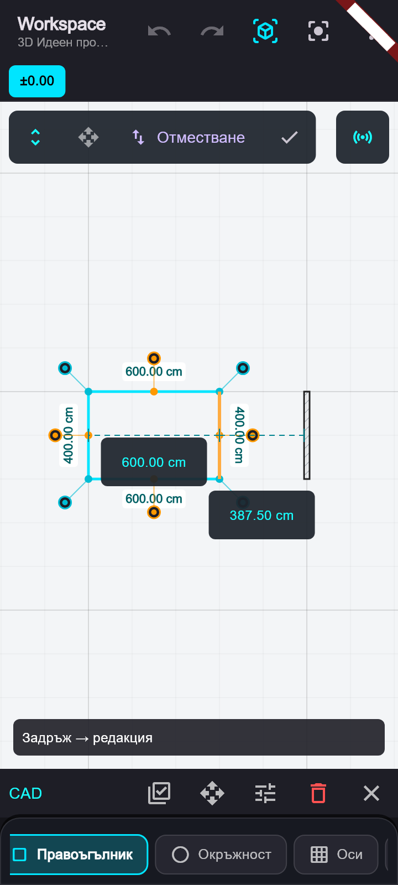
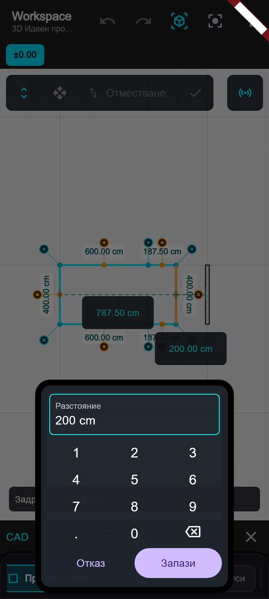
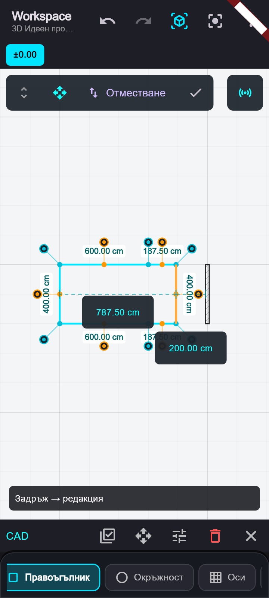

# Редакция на ръб чрез разстояние

Проектът е обновен от origin/main до `64c7ad7` чрез fast-forward.

Задържане върху правоъгълник или плоча → Редакция → клик върху ръб или неговата изнесена средна точка. Избраният ръб се оцветява в оранжево. Показват се кликаеми перпендикулярни размери до срещуположния успореден ръб и до най-близкия външен успореден ръб на стена, плоча или правоъгълник. Измерването изисква застъпване по направлението на ръба; при стените се използва физическата повърхност.

Клик върху размер задава крайното разстояние. Например 600 → 650 см означава отместване с 50 см. Мести се само избраният ръб. Бутонът „Отместване“ задава директна промяна; ± превключва навън/навътре спрямо контура. Останалите елементи остават неподвижни.

Общият цифров панел използва единиците на проекта и до два десетични знака. Предварителният изглед не променя модела; Запази създава една команда за Undo, Отказ връща началната форма. Невалидни контури не могат да се запазят. След промяната новият ръб остава избран. Изнесените точки вече компенсират отстоянието си от ръба, така че няма първоначален отскок.

Кратките надписи и подсказките са в EN/BG ARB. На телефон панелът стои долу, оставяйки формата видима. Редакцията приключва с ✓; режимите за местене и множествен избор също приключват редакцията на ръб.

Проверки: архитектурният модул и споделените оси — 282 успешни теста; разширеният набор за размерите — 7 успешни теста, включително два добавени след общия прогон. Статичният анализ е чист. Телефонните сценарии са проверени при 360×800 с българска локализация.

## Успоредно местене на цял ръб

В Редакция има два режима: изтегляне (икона с две стрелки) и успоредно местене (икона с четири стрелки). Режимът за местене премества двата края с един и същ вектор, запазвайки дължината и посоката на отсечката. Съседните отсечки следват новите крайни точки. Старите позиции на преместените крайни точки не се добавят като нови върхове.

В режима за местене отсечката може да се хване със задържане по дължината ѝ, през средната или изнесената точка. Снапът на единия край коригира успоредно и другия. Кликаемите разстояния и отместването със ± използват избрания режим. Старото изтегляне остава налично. Самопресичане и обръщане на контура се отхвърлят; промените запазват свойствата на плочата и се отменят с едно Undo.

След добавянето на режима: 291 теста на архитектурния модул и споделените оси минават; статичният анализ е чист. Проверени са двете посоки на контура, завъртяна геометрия, снап, задържане далеч от средната точка, числово въвеждане в см, Undo и режимите на телефон.

