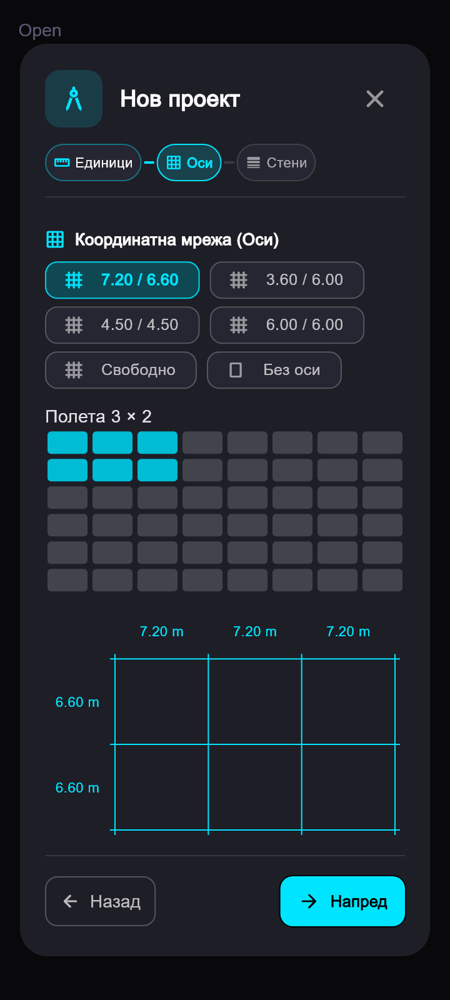
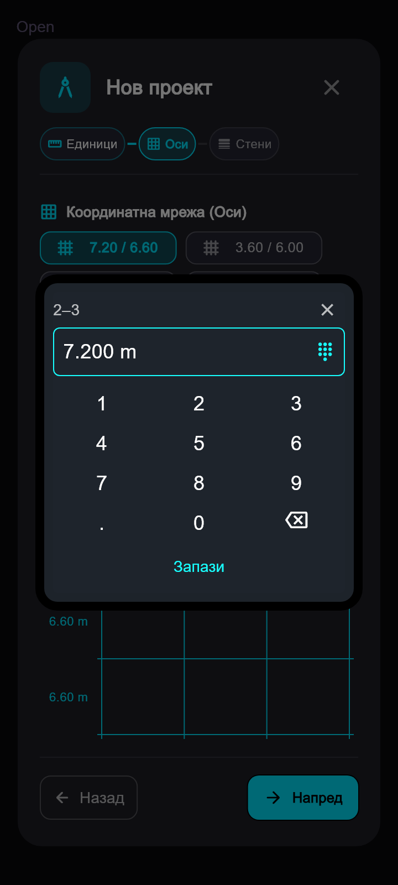

# Интерактивни оси

## Схема във вълшебника

Избор с докосване или изтегляне по решетка, както при поставяне на таблица.
Избират се полета между осите: 3 × 2 полета създават 4 × 3 оси.
Броят полета се задава в самата решетка. Пресетите задават начални
междуосия; всеки размер след това се редактира независимо. Редът X/Y
с +/− и отделните бутони за междуосия са премахнати.

Размерите са над съответните колони и до редовете на самата мрежа с осите.
Докосването на надпис отваря местното цифрово пано, без системната клавиатура.
Двойката оси се вижда в паното и в tooltip. Големите схеми се превъртат
хоризонтално, за да останат размерите достъпни. Числото следва
избраните единици, но геометрията се съхранява в метри. Прегледът показва
действителните пропорции; позициите са натрупаните отделни междуосия.

На телефон заглавието и табовете са кратки. Пояснението за избор на полета е
в tooltip. Всички UI думи, включително помощта за готовите схеми, са локализирани чрез
ARB на български и английски. Имената на стените във вълшебника използват
отделни локализирани надписи, без изрязване на части от превод. Правилото
за локализация е записано в AGENTS.md.

## Подравняване в чертежа

При изтегляне на край на избрана ос всички успоредни оси приемат общите ѝ
краища още в прегледа. Междуосията се запазват. Поддържат се завъртени оси
и обратна посока на начертаване. Минималната дължина е 30 см.

При местене на цяла ос само нейната позиция се измества напречно;
успоредните оси подравняват обхвата си по дължина. Нормалното разстояние
до останалите оси се редактира така, без да се мести цялата схема.
Неуспоредните оси остават на място.

Новата начертана ос следва обхвата на успоредните оси и го показва преди
поставяне. Втори пръст отменя цялата редакция. При отпускане всички засегнати
оси се записват с една Undo стъпка.

## Ос върху стена

При активен инструмент „Оси“ едно докосване на стена поставя ос през
центъра на нейното ядро. Изолацията и водещата линия не изместват тази ос.
При наличие на действително успоредна ос краищата се подравняват с нея.
Близък наклон не променя посоката на оста на стената. Ако ос по същата
линия вече съществува, тя се избира, без дубликат или нова Undo стъпка.

След избор оста може да се редактира със задържане както останалите елементи.
Изборът на стени остава в инструмента „Стена“.

## Проверка

Преди тази промяна минаха 240 теста за архитектурата, общите BIM оси,
координатите и снапа. За новата редакция върху схемата минават 34 теста
за схемата, вълшебника и типовете стени; анализът е чист. Проверени са
размери по двете направления, избрани единици и превъртане до последното
междуосие на телефон, на български и английски.
17 нови теста покриват отделни междуосия и запис/зареждане, подравняване
на прави/завъртени/обратно начертани оси, динамичен преглед, отказ при pinch,
Undo, ядра при всички водещи линии, близки наклони, дубликати, реално
поставяне върху стена и целия вълшебник. Телефонният изглед 360 × 800 и
местното цифрово пано са проверени визуално и с widget тестове.

