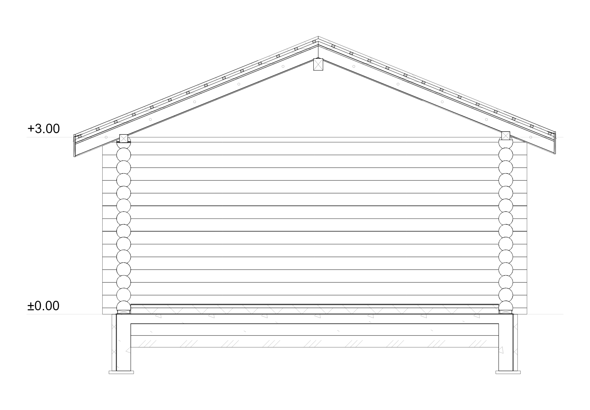
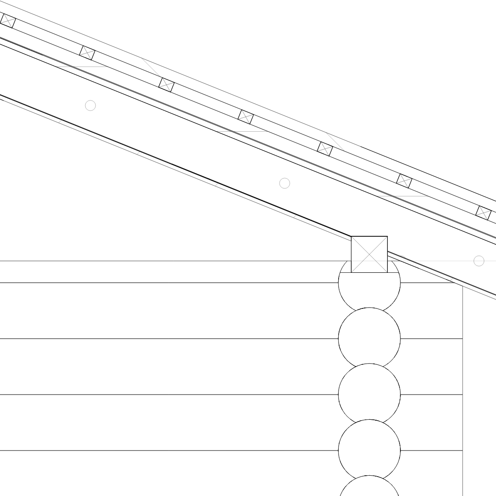
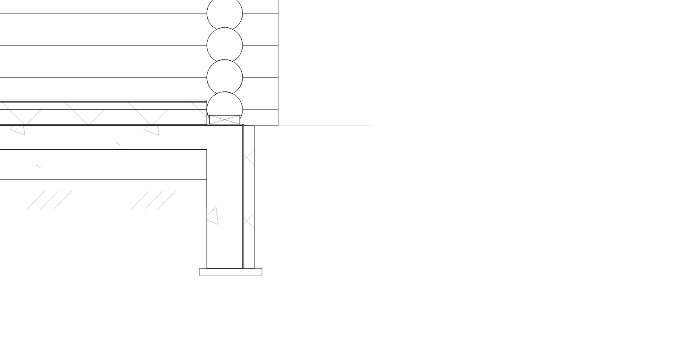

# Трупи, плоча и ръчно позициониране на покрива — 29.10.2026

Проверено с `log_ArchBimPackage(1).zip` и двете приложени изображения. Оригиналният архив не е променян. Регресионното копие на `architectural.json` е `test/fixtures/bim_package_log_details_2026_10_29.json`, SHA-256 `56c7fd25b8a0cf018b880c864747a735a90576ec7cc9150d20827fb16ab445ae`.

## Причини и корекции

- **Накъсаните дъги** идваха от обединяването на всички допиращи се трупи в общ контур за рисуване. Това премахваше части от общите дъги и оставяше дребни фрагменти. Всеки курс вече запазва затворения си профил след реалните изрязвания. Щриховката на трупите в разрез е изключена; опорните греди запазват обичайното означение за напречно срязано дърво. Промяната се запазва и при отражение и стъпаловиден разрез.
- **Частичната плоча** всъщност беше частично изрязана подложна основа. Бетонното ядро е по целия зададен контур. Една от стените в пакета има външна страна към вътрешността; старото изрязване продължаваше два метра навътре и премахваше баластрата и уплътнения насип. При периферен възел посоката вече се определя от действителния край на плочата, а изрязването използва нейния обхват. Същата посока се използва за вертикалната изолация, хидроизолацията и капелника. Стенните оси и записаните страни не са променяни.
- **Покривният възел** използваше две различни опори: разрезът поставяше хоризонтален мауерлат по действителното ядро на стената, а 3D изрязваше наклонена греда по теоретичната линия на надвеса. Общият физически мауерлат вече определя сечението, 3D обема, леглото на ребрата и изрязването на трупите. Напречните, косите и надлъжните сечения използват същия обем; надлъжното сечение няма кръстосани диагонали. Вътрешните контактни лица на опростения покрив се премахват, за да не се проектират като паразитни линии между летвите.
- **Snap** използва основния покривен профил и номиналния горен ръб на стените. Летви, челни дъски, мауерлати и контури на стени, които вече следват покрива, не създават фалшив контакт при местене.
- **Височината на обикновените покриви** се изравнява еднократно. Старият флаг за привързване се изключва при вече позициониран покрив, без да променя записаната височина. Действието „По стените“ може да се избере изрично отново. За покривите над трупи то отчита реалното легло на мауерлата, долните покривни слоеве и наклона. Ръчното преместване маркира позицията като разрешена и тя се запазва при други редакции, Undo/Redo и повторно отваряне. Съществуващата изрична връзка на панелните покриви с избрани стоманени колони е запазена.

Новите етикет и помощен текст са в ARB за bg/en; подробното обяснение е в tooltip.

## Граници на детайла

Пакетът съдържа плоча с дебелина 16 cm и без зададен `assemblyId`. Слоевете на пода, подложната основа и ивичните основи в разреза продължават да са подразбиращият се библиотечен детайл. Корекцията възстановява пълния му обхват и почиства контактите; не създава липсващ конструктивен проект и не добавя тези подразбиращи се основи като записани 3D елементи. Ръчно зададените положения на двата ската са запазени.

## Проверка

Основният набор премина с **134 успешни теста** за геометрия, реални пакети, производителност, покривни опори, панелни покриви, Snap, Undo/Redo и телефонния интерфейс на bg/en. Допълнителният тест за вътрешните лица проверява конкретно паразитните линии след изрязването на опорите. Проверени са и затворените профили на трупите, пълната подложна основа, липсата на застъпване с мауерлатите, действителната дължина на надлъжното сечение и преместване с 2 mm. Контролните изображения са от реалния пакет, на бял фон.

Статичният анализ на засегнатите Dart файлове е чист. `git diff --check` преминава. Не е създаван APK; проверката на телефона е чрез Flutter widget тестове.

Повторение на специфичната регресия и изображенията:

```powershell
flutter test --no-pub test/features/architect/architect_log_details_package_test.dart --reporter expanded
flutter test --no-pub tool/diagnostics/architect_log_details_audit_test.dart --reporter expanded
```






