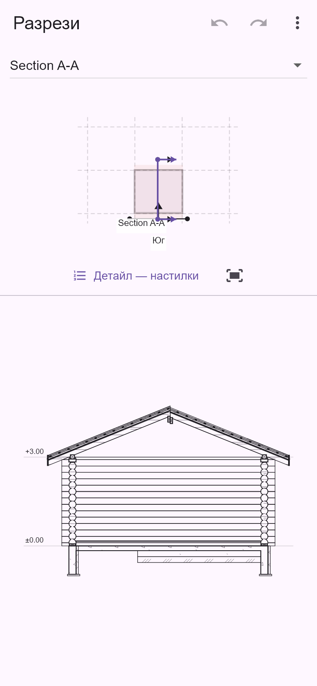

# Забавяне при стени от дървени трупи — 29.10.2026

Корекцията е проверена с реалния `log_ArchBimPackage.zip`: четири стени от кръгли трупи Ø24 cm, два ската и разрез A–A. Активният етаж в пакета е покривният; стените са в долния етаж. Оригиналният архив и записаните елементи не са променяни.

Регресионният модел е [bim_package_log_walls_2026_10_28.json](../test/fixtures/bim_package_log_walls_2026_10_28.json), SHA-256 `345fcd05992603a5a2d5b4ebd7a280636dc0f28831d8c34e96d706c789a07cc6`.

## Причина

Проблемът се получава преди фоновото изчисляване на видимостта. За всяка трупа основната нишка построява затворен обем, изрязва надлъжния канал, седловите сглобки, отвори и контактите с други елементи. Копланарните фрагменти се обединяват, минават повторно през Flutter Path и се триангулират на вертикални ленти. Последното умножава триъгълниците по челата и изрязаните повърхности. Самото пресичане с равнината на разреза също остава синхронно.

Преди корекцията четирите стени дават **82 069 триъгълника в 58 строителни компонента**. Само студеното построяване на обемите отнема 3 504 ms на тестовия компютър; първото построяване на сечение без видимата проекция блокира основната нишка за 5 131 ms. На телефон тези стойности не могат да се приемат за горна граница.

## Промени

- Простите чела се триангулират с `n − 2` триъгълника. Контурите с дупки запазват съответното правило на запълване; несвързаните външни контури се обработват независимо.
- Обединените копланарни повърхности се триангулират непосредствено в double precision. Отпада междинният float32 Path и построяването на ненужни странични и долни лица за плосък капак.
- Native Path подготовката остава в основната нишка. Булевите изрязвания на компонентите, почистването на контактните повърхности и пресичането с равнината на разреза работят в worker isolates.
- Разрезът, фасадата и 3D използват общите кеширани строителни обеми. Ключовете различават действителни отвори, временно запълнени отвори и вариантите за сечение. Нова ревизия на проекта получава собствена геометрия.
- Интерактивните разрези, фасади и специални стени в 3D се зареждат асинхронно. Заявките се обединяват до последната чакаща; остарял резултат не се публикува в друг изглед. Първото напасване на камерата изчаква резултата. Използвани са съществуващите локализирани състояния за изчисляване и повторение.
- В сечението контурите на трупите се обединяват пакетно. Физически разделените курсове не се изваждат повторно от постоянно растящ двумерен остатък.

**Не е намален броят от 48 страни на кръглия профил.** Запазени са редуването на курсовете, издадените краища, седловите изрязвания, каналите, касите и реалните контакти. Оптимизацията не замества трупите с правоъгълни стени.

## Измервания

Flutter debug тестове на същия компютър; стойностите са диагностични, а не измервания от физически телефон.

| Показател | Преди | След |
| --- | ---: | ---: |
| Триъгълници на строителните обеми на трупите | 82 069 | **37 499** (−54,3%) |
| Компоненти | 58 | 58 |
| Студено построяване на тези обеми, синхронен диагностичен път | 3 504 ms | 2 441 ms |
| Мрежа за проекцията, целият модел | 72 931 | **42 493** |
| Сечение при вече готови обеми, преди/след фоновото пресичане | 1 653 ms | **294 ms** |

Профилирането на асинхронния път измерва приблизително 2 852 ms за подготовка на обемите и повърхностите, 75 ms за фоновото пресичане, 294 ms за останалата подготовка на сечението и около 3,1 s за завършване на проекцията. В тези числа има диагностични паузи от 20 ms. Най-дългият наблюдаван интервал между събитията на основната нишка е около **439 ms**; през продължителната булева обработка таймерите продължават да се изпълняват. Общото изчисляване още отнема секунди, но тежките числени операции вече не блокират интерфейса за цялото си времетраене.

Кешираните контури се използват повторно при местене на чертежа. Финалният A–A запазва 99 сечени региона и 44 видими проекционни контура.

## Проверки

**145 успешни целеви теста** в три групи: 112 за геометрия/материали/покриви/разрези/отводняване и worker обработката; 30 за фасадите, редактирането и камерите; 3 за реалния пакет на телефонен размер, включително български и английски. Статичният анализ на 17 засегнати Dart файла е чист. `git diff --check` преминава.

Новите регресии проверяват дупки и вдлъбнати чела, реални затворени обеми, непрекъснато обработване на събития, лимит на триъгълниците, правилни варианти на отворите, промени на модела, съвпадение на асинхронния разрез с публикационния резултат, зареждане на фасада/3D и повторно използване на контурите при навигация. Съществуващият тест измерва кръглия профил от двете страни с точност 0,5 mm.

В допълнителния CAD3D пакет остава старият неуспешен тест `preview plates use each storey footprint and concave zones keep their area`: той очаква условна етажна плоча, която генераторът не добавя. Същият неуспех е възпроизведен с копие на `architect_3d_builder.dart` от HEAD. Този тест и моделът не са променяни, за да се добави фиктивна геометрия.



## Повторение

```powershell
flutter test --no-pub test/features/architect/architect_log_wall_performance_test.dart --reporter expanded
flutter test --no-pub test/features/architect/architect_log_wall_phone_test.dart --reporter expanded --dart-define=LOG_QA_CAPTURE=true
flutter test --no-pub tool/diagnostics/architect_log_wall_audit_test.dart --reporter expanded --dart-define=LOG_AUDIT_MODE=geometry
flutter test --no-pub tool/diagnostics/architect_log_wall_audit_test.dart --reporter expanded --dart-define=LOG_AUDIT_MODE=stages
```

Остават необходими измервания на конкретния телефон в profile/release режим за общо време, памет и кадри при навигация. Общият CAD3D панел допълнително подразделя големи триъгълници за софтуерен рендер; тази мрежа не се използва при изчисляването на разрезите. Не е създаван APK.
