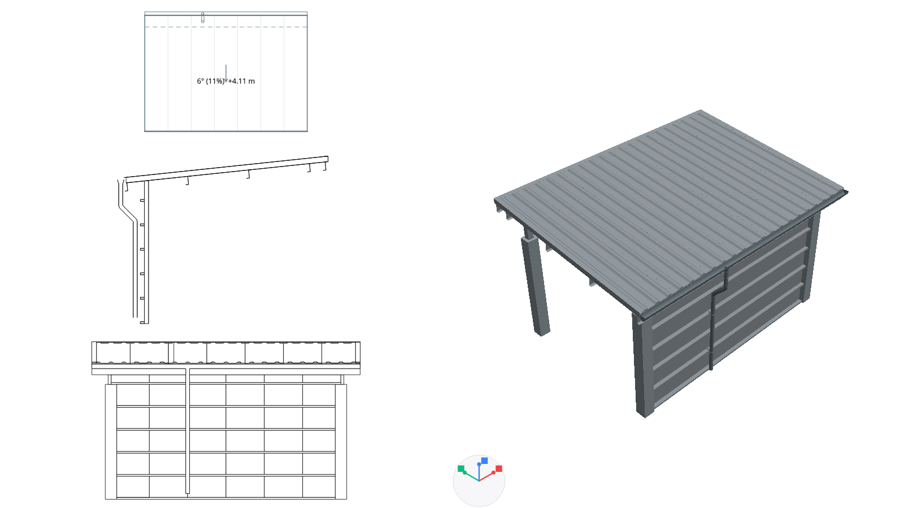
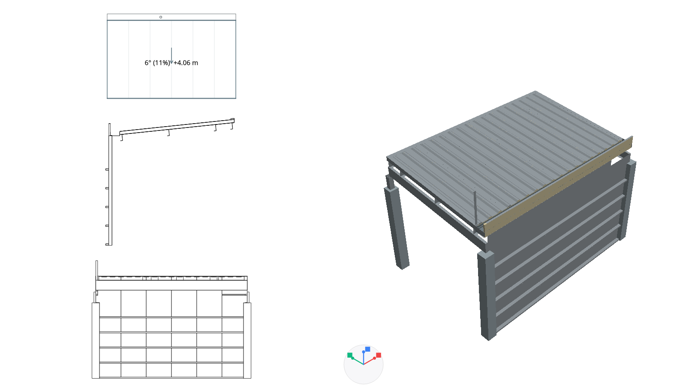
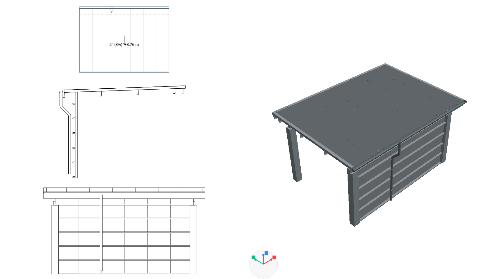
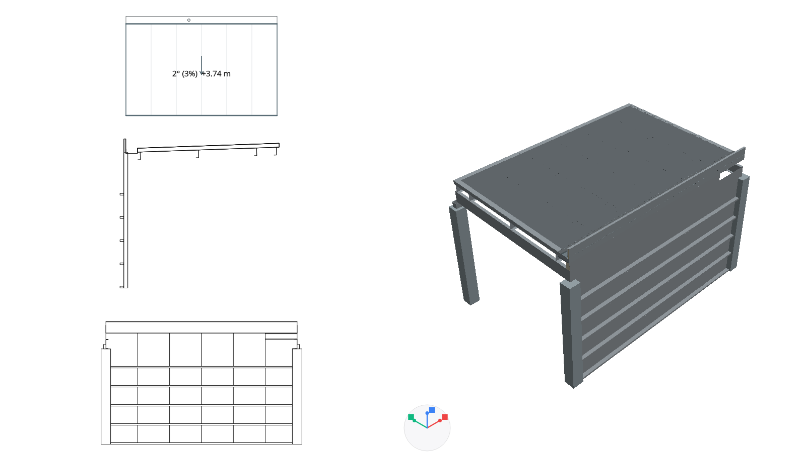

# Термопанелни покриви — реализация

26.10.2026 г.

## Използване

В **Покрив → Състав** изберете **Термопанели · скатен** или **Термопанели · мембрана**.

- **Скатен**: профилирана горна метална обшивка, PIR ядро и долна обшивка. Панелите са цели по ската.
- **Мембрана**: плоска панелна основа с горна хидроизолационна мембрана. Началният наклон при избор на шаблона е 2°.
- Размерите на панела и металната конструкция са отделни. Конструкцията се разгъва от **Метална конструкция**, опорите — от **Опорни колони**.
- В **Детайли → Отводняване → Разположение** има **Външен** и **Вътрешен** улук. Размерите и видимостта на улука/тръбите се задават независимо.
- При създаване на нов покрив стрехата може да бъде 0 или желано издаване. Съществуващият покривен контур се редактира в план; номиналният монтажен параметър не се представя като измерено издаване на вече редактиран контур.
- Автоматичният панелен покрив отчита и колонната мрежа. При избор на плоска форма профилираният шаблон се заменя с мембранния, със запазен отводнителен наклон.

Всички нови надписи, съобщения и пояснения са в ARB за български и английски. Новите настройки се записват в проекта и участват в общия механизъм за Undo/Redo и редактиране на група скатове.

## Начални параметри

| Елемент | Начална геометрия |
| --- | --- |
| Панел | 100 mm номинална дебелина, включително две обшивки по 0.5 mm |
| Панелен модул | 1000 mm |
| Профилирана горна обшивка | Три трапецовидни ребра в модула, 35 mm височина |
| Z-столица | 200 mm височина, 70 mm пояс, 2.5 mm метал, стъпка 1500 mm по ската |
| Главна I-греда | 300×150 mm, 6 mm стебло, 10 mm пояси |
| Рамки без избрани колони | Редактируема стъпка, начално 3000 mm |
| Отдръпване на ядрото при свободна стреха | 50 mm по ската; горната обшивка продължава до края |
| Борд при вътрешен улук | Начално 250 mm над покривния габарит |

Номиналната дебелина на панела не включва конструкцията и височината на профилираните ребра. Смяната ѝ премества горните покривни повърхности, без да преоразмерява гредите, столиците или профила.

Минималният наклон е параметър на избраната система: начално 4° за профилирания и 1.2° за мембранния вариант. Под минимума записът се отказва с локализирано съобщение, а редакторът остава използваем. Началните стойности са проектни настройки; зависимостта от конкретния продукт и напречните снаждания е описана в [плана с първичните източници](architect_panel_roof_plan_2026_10_26.md).

## Геометрия и възли

`ArchitectPanelRoofGeometry` изгражда затворени тела за всяка обшивка, ядро, мембрана, столица, греда и обшивка на ръб. Планът, фасадата, разрезът и 3D използват един и същ модел.

- Празното пространство между металните профили остава празно. В разрез не се появява плътен „стоманен слой“ с височината на цялата конструкция.
- Главните рамки следват ID и положенията на избраните колони. При по-ниска колона има куха метална надставка до наклонената носеща равнина; самата колона не се удължава скрито.
- При включено привързване котата следва избраните опори, включително колони от по-долен етаж. Преместване, височина или кота на опорния етаж преизчисляват зависимата покривна кота.
- Липсващите колонни ID се запазват и се показва съобщение. Котата се запазва до поправяне на връзката; не се избира мълчаливо заместител.
- Термопанелната стена достига долната покривна обшивка. Гредите и столиците изрязват действителните си контакти със стенните компоненти.
- Отворите в покрива изрязват панелите и пресечените метални компоненти. Произволен отвор не получава автоматично изчислена усилваща рамка или заводски покривен прозорец.
- Свободните странични ръбове имат тънки метални затваряния и горни обшивки. При съвпадащи общи ръбове една сгъната обшивка покрива двете страни на билото/външното ребро.
- При улама покривните панели отстъпват от общия ръб; има едно понижено метално корито и затваряне на отрязаните панели. Не се поставят два външни улука или билна шапка през водосъбирателната ивица.
- Вътрешният улук запазва открито корито в изрязана покривна ивица. Над него няма панел или мембрана. Външният борд е с изолация, метални страници и капак.
- Вътрешната тръба се спуска вертикално. Пресичане с колона, стена, греда, плоча без отвор, друг покрив или покривна конструкция се отчита като блокирано трасе. Не се чертае тръба през препятствието.
- Тънките обшивки използват съществуващия визуален приоритет за облицовки в 3D. Той не променя координатите или размерите в сеченията; предотвратява просветване на изолацията при ограничена дълбочинна точност на визуализатора.

## Контролни изображения

Вляво: план, разрез и фасада. Вдясно: действителният 3D модел. Планът използва съществуващия генератор, шрифт и печатен мащаб; разрезите режат действителните затворени компоненти.

## Проверки и граници на модела

Новите тестове проверяват непрекъснато покритие по всички модули в действителната 3D мрежа, кухи I/Z-профили, смяна на дебелина, отдръпнато ядро, стреха 0/0.5 m, отвори, вътрешен/външен улук, свободно корито, колизии на тръби, покривни сечения, било/улама, опори от друг етаж, изтрити опори, сериализация, локализиран телефонен редактор, ограничения на наклона и Undo/Redo.

Редакторът е проверен на 320 px в светла тема и на 390 px в тъмна тема, на български и английски. Включен е регресионен пакет за съществуващите покриви, улуци, разрези, фасади и новите специални стени.

- 33 нови покривни проверки: 18 геометрични/моделни и 15 UI/визуални.
- Общо 200 успешни проверки в засегнатия пакет от 19 тестови файла.
- Статичен анализ на архитектурния модул и новите тестови файлове: без забележки.
- Проверява се и запазването на правите ъгли на завъртяното Z-сечение; профилът се завърта към ската, без да се сплесква.

Моделът е за архитектурна геометрия и чертежи. Няма автоматично конструктивно оразмеряване, изчисляване на дебит, надлъжен наклон на улука или аварийно преливане. Заводски самонарезни крепежи, анкери, уплътнения, напречни панелни снаждания и сложни частични пресичания на обшивки остават специализирани детайли. Пречупен мансарден скат се отказва за тази система; той изисква отделни панели и възел при пречупването.
