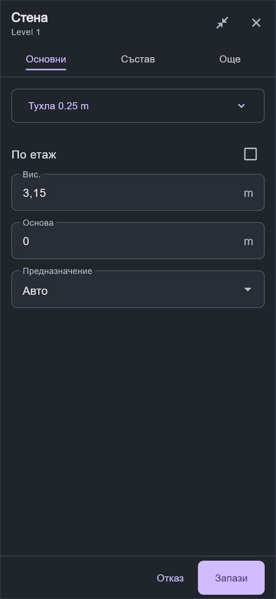
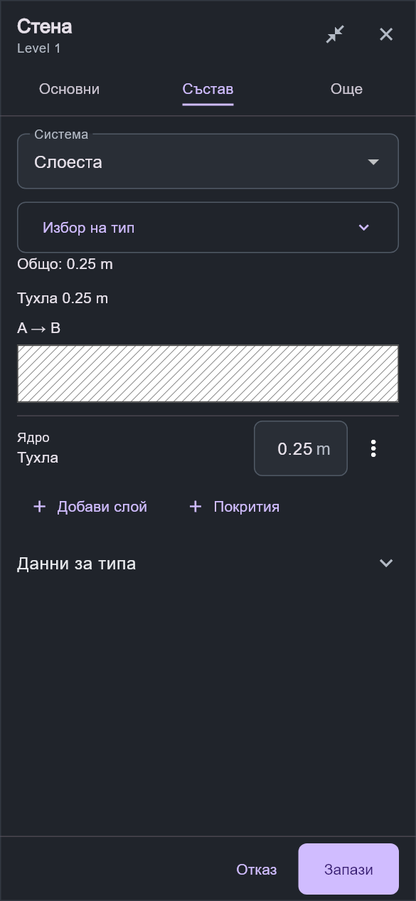
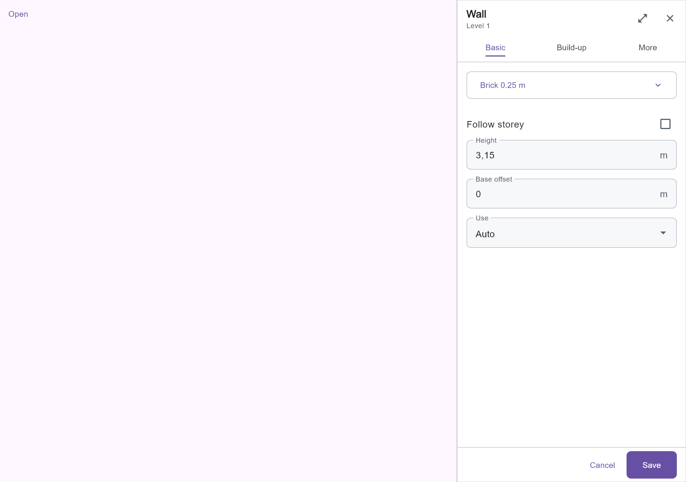
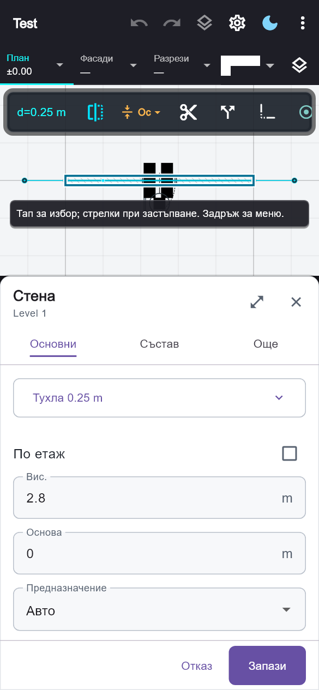

# Архитектурни свойства — обновяване на редакторите

## Работа и оформление

Редакторите използват обща неутрална рамка със светла и тъмна тема. На телефон основните свойства се отварят в долен панел с разгъване до цял екран. Видимата част от плана получава собствено място, така че избраният елемент да остане над панела. При ширина от 1000 логически пиксела редакторът е десен панел 400 px; автоматичното разгъване при смяна на раздел е само за тесни екрани. Ръчното разгъване запазва черновата.

Стената има „Основни“, „Състав“ и „Още“. Височината, основата, типът и предназначението са първи. Съставът използва съществуващия пълен редактор, включително специалните стенни системи и цокъла, в общата сесия. Общата дебелина е изчисляема. Вратите и прозорците показват преглед с производствената планова геометрия. Диаметърът на кръгла колона заменя общия етикет за ширина.

Плочи, покриви, стълби, компоненти, разрези и фасади използват същата рамка. Обикновените елементи, помещенията, котите, текстовете и CAD примитивите използват общите директни полета. Контекстната карта на осите следва темата.

## Промени и съвместимост

- Числата се редактират непосредствено. Точка и запетая се приемат като десетичен разделител; моделната точност се запазва.
- Предварителният преглед остава извън модела, Undo и автоматичния запис. „Запази“ публикува целия резултат веднъж; „Отказ“ отхвърля сесията.
- Затварянето при промени предлага запис, оставане или отхвърляне. Невалиден вход не се заменя безшумно с предишна валидна стойност.
- Източникът на документа се проверява преди запис. Сесиите не презаписват остарял проект.
- Смесените логически стойности не се вземат от първия избран обект. Обръщането на смесена група обръща всяка стена поотделно. Различни стенни състави изискват изричен избор на заместващ тип.
- Площите използват m² / sq ft, независимо от единицата за дължина. Целевата площ може да бъде зададена и изчистена. Теглата на линиите остават в хартиени mm.
- Новите съобщения са в ARB на български и английски. Фабричните стилове за врати и прозорци използват локализираните си имена.
- Новите интерфейси `ArchitectPropertiesSession`, `ArchitectPropertyDescriptor` и `ArchitectPropertiesShell` са вътрешни. Съществуващите callback интерфейси са запазени чрез адаптери; `clearValues` е незадължителен аргумент на командата за свойства. Не е нужна миграция на проектни файлове.

## Проверки

Регресионният пакет обхваща 134 проверки: адаптивно оформление, групови стойности, отказ, еднократно Undo/Redo, състави, плочи, покриви, стълби, стилове на линии, запълвания и редакция на реални елементи през разрез и фасада. Новият файл `architect_properties_redesign_test.dart` съдържа 14 целеви проверки, включително 320/390/1200 px, bg/en, увеличен текст 200%, клавиатура, невалиден слой, смесено обръщане и преглед на дълбочина в единиците на проекта.

Статичният анализ на архитектурния модул и променените тестове е чист. Проверени са наличието и стойностите на новите ARB съобщения за двата езика. Снимките са от рендерирани Flutter widget тестове.

## Визуална проверка

| Телефон — тъмна тема | Състав |
| --- | --- |
|  |  |

