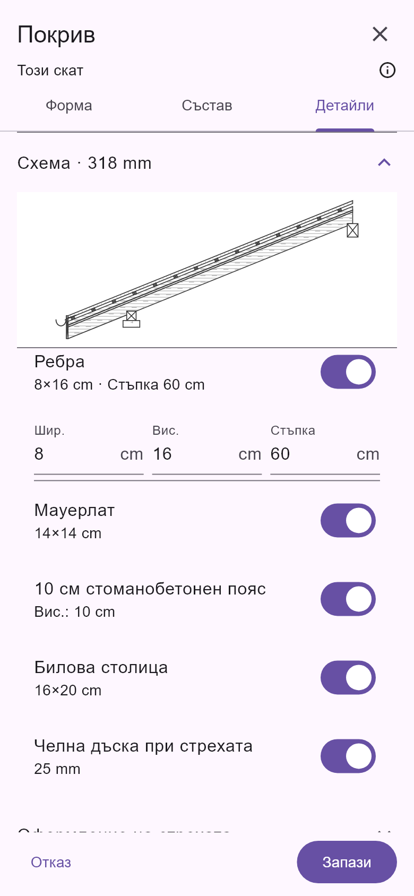
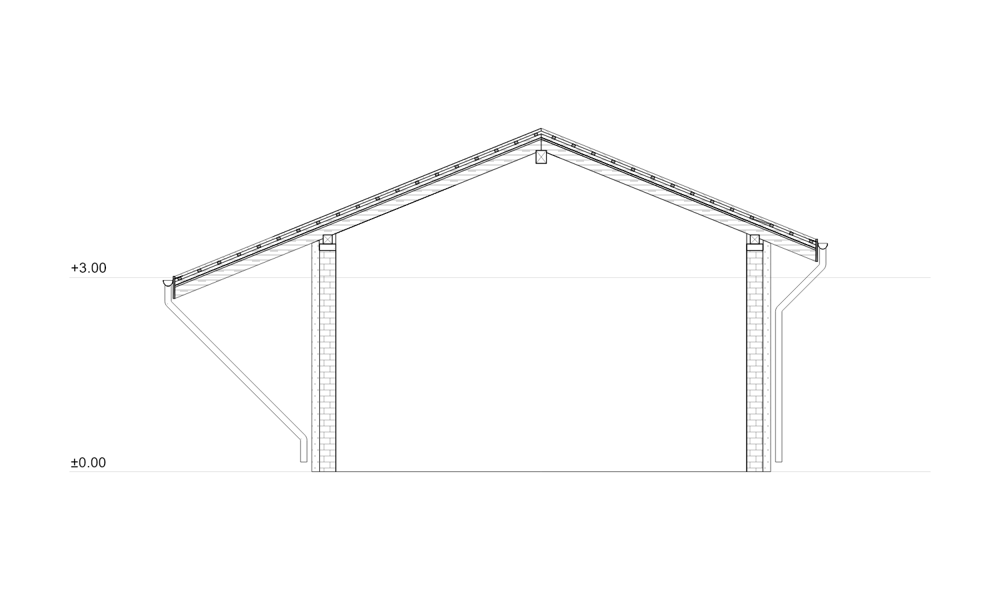
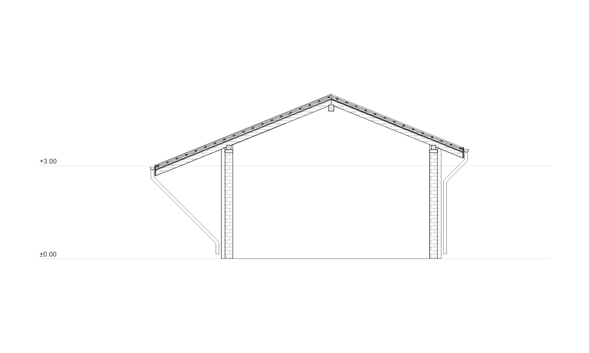
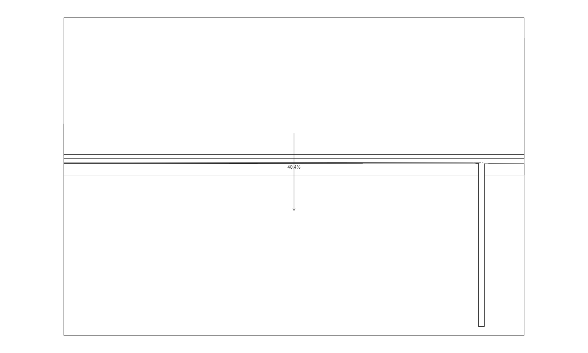

# Динамично превю и изчистени водосточни тръби

## Покривна конструкция

Превюто е върнато над разделите „Форма“, „Състав“ и „Детайли“. По подразбиране е отворено, може да се сгъне, а докосване на изображението отваря цял екран с мащабиране.

Използва действителния генератор на покривни сечения с временните стойности от редактора. Наклонът, слоевете, сеченията на дървените елементи, опорите, челната дъска и включеният улук се обновяват преди запис. При редакция се използват избраният покрив и неговите носещи стени; при нов покрив се показва примерна опора. Моделът не се променя от превюто. Числовите стойности в полетата остават точните размери.

На нисък екран превюто има компактен достъп до цял екран; при отворена клавиатура височината му се намалява. Схемата използва бяло поле, тънки линии и материални щриховки.

## Една геометрия, представяне според чертежа

| Контекст | Представяне на ВТ |
| --- | --- |
| 3D | Кухи профили, плавни колена, муфи, скоби и монтажни елементи. |
| План | Съществуващите планови контури на улука и трасето. |
| Действителен разрез | Кухото сечение на тръбата/канала, без монтажните подробности и завалцованите бордове от 3D. |
| Фасада и проекция зад разрез | Видим външен контур, без надлъжните ръбове на полигоните, муфи и скоби. |

При проекцията първо се изчисляват действителната видимост, препятствията и дълбочината, след което видимите повърхности на отводняването се обединяват в контур. Скритите части не се рисуват през стените. Изборът на елемента, настройките за видимост и публикуването използват същата геометрия. Фоновите контури в разреза са тънки, но достатъчно контрастни за четим печат.

## Чупка под челната дъска

Първият прав участък вече не се определя само от минимална дължина 10 cm. Изчислява се и долният ръб на покривната конструкция при стрехата. Към необходимото слизане се добавят радиусът на тръбата, максималното издаване на фитинга и 10 mm свободно отстояние. Така първата чупка се формира под челната дъска, включително когато покривът е по-дебел.

Общото трасе се използва в плана, 3D, разреза и фасадата. Не се прикрива колизия само чрез изтриване на линия от чертежа.

## Проверка

- 113 успешни регресионни теста за покриви, отводняване, сечения, фасади, UI и публикуване.
- Проверка на реалния подробен 3D обем спрямо челната дъска: различни дебелини на конструкцията 12–60 cm, дъска 20–120 mm, наклони 22°/60°, както и двата прикачени разреза B–B/C–C.
- Проверка, че фасадата няма вътрешни надлъжни линии в силуета на тръбата, докато 3D запазва монтажните подробности.
- Превюто е проверено в bg/en при промяна на наклон и ребра, смяна на раздел, цял екран и нисък екран.
- Подсказката е обновена в ARB за bg/en. Статичният анализ на променените файлове е чист.

