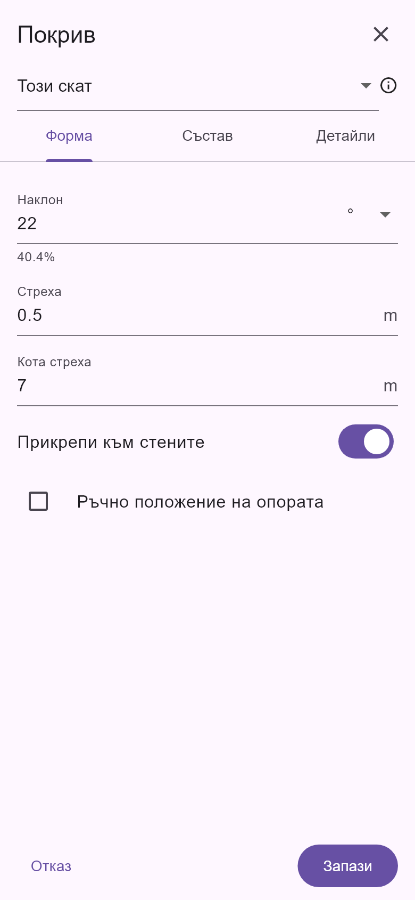
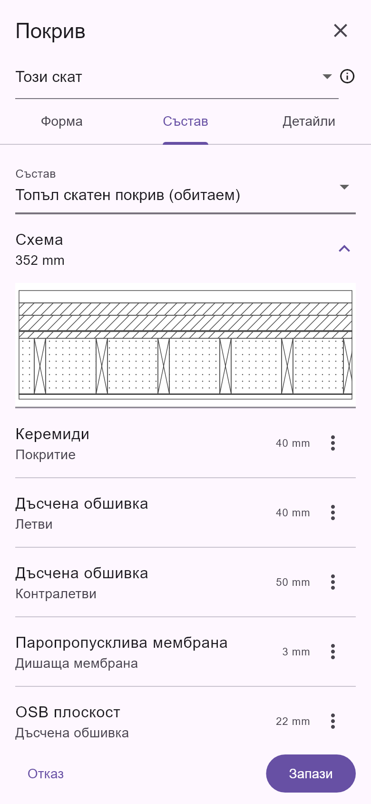
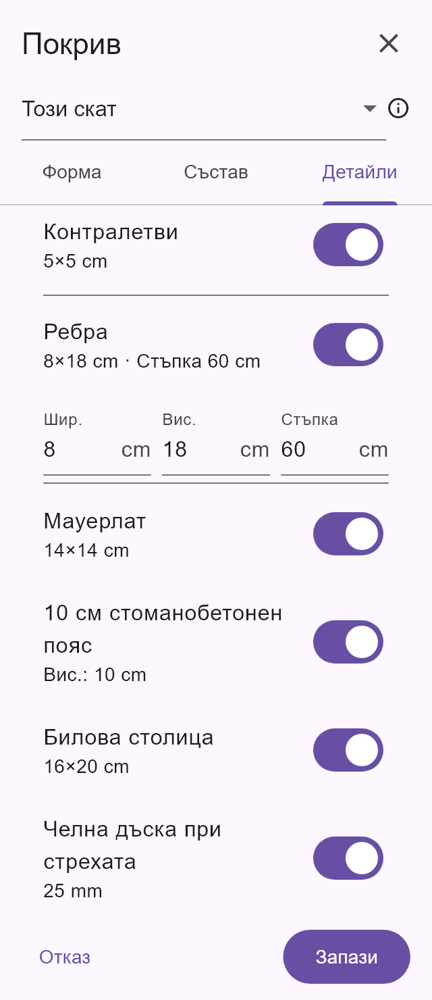
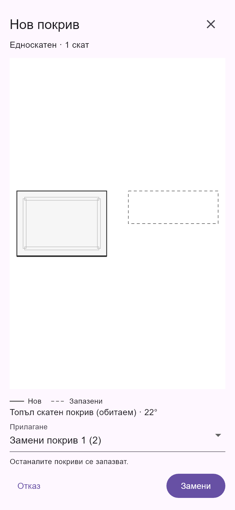

# Покриви: контекстна лента и редактор за телефон

Реализирана е одобрената първа стъпка на UI оптимизацията за покривите.

Последващите корекции по отводняването, материалните щриховки и премахването на номиналния показател Eaves са описани в [проверката на C–C](architect_section_cc_corrections_2026_10_25.md). Телефонните снимки по-долу документират първоначалния UI етап.

## Работа върху чертежа

- Без избран скат: избор на начин на създаване, „Състав“ и настройки. Менюто съдържа ръчните режими и отделна група за автоматично генериране.
- По време на чертане: завършване, връщане на последната точка и отказ. За режими с две точки се показва броят въведени точки.
- При избран скат: точни наклон и стреха, настройки и меню за по-редките операции. Избран подходящ ръб получава пряко действие за задаване като стреха.
- Завъртане, обръщане, мансарден режим, свързани наклони и изравняване на билото остават достъпни в менюто.

## Редактор

На телефон редакторът заема целия екран. Има три раздела:

1. **Форма** — наклон, стреха, кота, прикрепване към стените, ръчна опора и мансардно пречупване.
2. **Състав** — начален шаблон, разгъваема схема и списък на слоевете.
3. **Детайли** — сгъваеми групи за дървените елементи, среза при стрехата и отводняването.

Наклонът се въвежда в градуси или проценти. Превключването на единицата променя представянето, без да променя физическата стойност. Под полето се показва кратка еквивалентна стойност в другата единица. Геометричните дължини следват единиците на проекта. Дебелините на слоевете са в mm и приемат фини стойности, например 0.2 mm, без старото ограничаване от плъзгач.

Докосване на слой отваря материал, роля, дебелина и позиция. Менюто на реда съдържа редакция, преместване нагоре/надолу и изтриване. При добавяне позицията се избира изрично. Запис на непроменен слой не превръща състава в потребителски.

Шаблонът променя състава, без да презаписва наклона и стрехата. Промени на височините на летви, контралетви и ребра синхронизират съответните конструктивни слоеве.

Схемата използва бяла основа, тънки неутрални линии и редки щриховки. Тънките мембрани остават видими, а числата в полетата са действителните размери.

## Обхват, настройки и Undo

- При съществуващ покрив обхватът е явен: „Този скат“ или „Покривът (N)“.
- Към групата се прилагат само редактираните полета. Различните наклони, коти, стрехи и стилове на останалите членове се запазват, ако съответното поле не е променено.
- Редакция на наклона само на един скат го прави независим от свързаните наклони. Поведението е обяснено в подсказката за обхвата.
- Местата и идентификаторите на тръбите се променят само за избрания скат. Към групата могат да се приложат редактираните общи свойства на отводняването.
- Редакцията на покрив не променя автоматично инструмента за следващите покриви. За това има отделен избор „За следващите покриви“; запазват се стилът и настройките без позициите на тръбите.
- Едно записване към група е една команда и се отменя с един Undo.
- Ако проектът е променен, докато диалогът е отворен, записът се отказва вместо да приложи остаряла снимка на данните.

Числовата валидация показва раздела и разгъва групата с грешното поле. Ръчната опора и мансардното пречупване се проверяват спрямо съответния скат; неподдържана стойност за пречупване не се приема със скрито ограничаване.

Изолацията между ребрата и ребрата използват една конструктивна зона. Добавяне на изолация към съществуващ запис за ребра заменя този запис в зоната, вместо да добавя втора дебелина. Изолация над височината на ребрата или два записа за общата зона се отхвърлят. При частично запълване, например 10 cm изолация в 18 cm ребра, общата конструктивна височина остава 18 cm; незапълнената част е въздух. Същата дълбочина се използва в модела и при сеченията.

## Автоматично създаване

Преди запис се показва планов преглед с новите и запазените покриви. Новите контури са плътни, запазените — прекъснати; цветът не е единственият отличителен признак.

Потребителят избира добавяне, замяна на конкретен покрив или изрично замяна на всички скатове на активния етаж. Ако има няколко покрива и няма избран, изборът на обхват е задължителен. Отказът не променя проекта. Генерирането запазва целия редактиран състав, включително фини дебелини, вместо да възстановява фабричния шаблон. Записът и замяната се отменят с един Undo, а покривите извън избрания обхват се запазват.

Проектна библиотека с именувани рецепти за покриви е извън този етап.

## Проверка

- 118 успешни проверки: UI, команди, Undo, поддръжки, геометрия, връзки, мансарди, отводняване, пакет за отводняване и привръзки при чертане.
- Статичният анализ на 16 променени файла за покривите е чист; `git diff --check` минава.
- Лентата е проверена при 320/390/1200 px в bg/en, включително чертане и избран ръб.
- Проверени са точни слоеве 0.2/400 mm, градуси/проценти, независимост на настройките, групова редакция и запазване на отделния покрив при замяна.
- Всички нови UI надписи и подсказки използват ARB за двата поддържани езика — bg/en.
- Реални Flutter екрани са визуално проверени при 320 и 390 px:

| Форма | Състав |
| --- | --- |
|  |  |

| Детайли, 320 px | Автоматично създаване |
| --- | --- |
|  |  |
