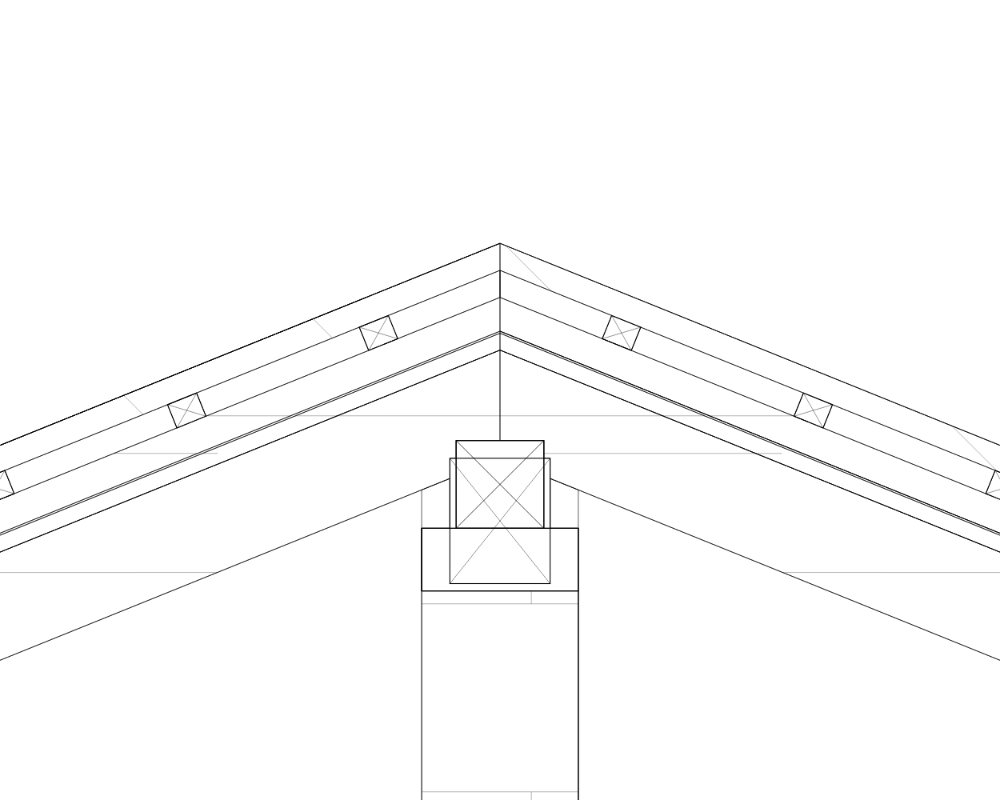
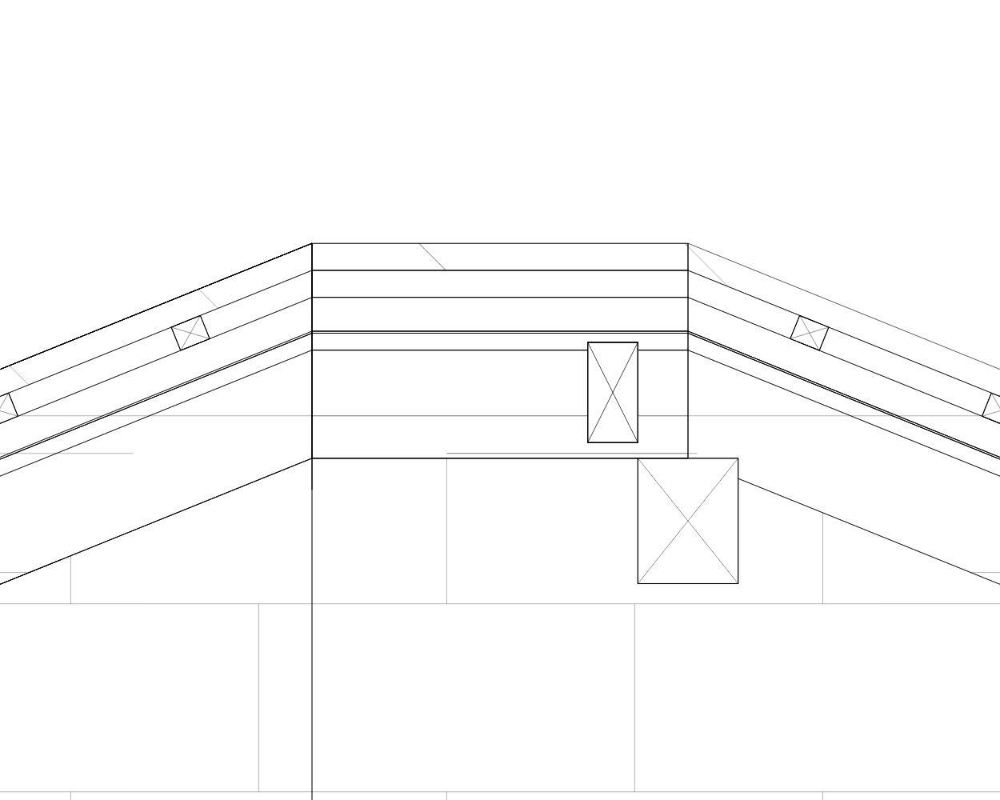
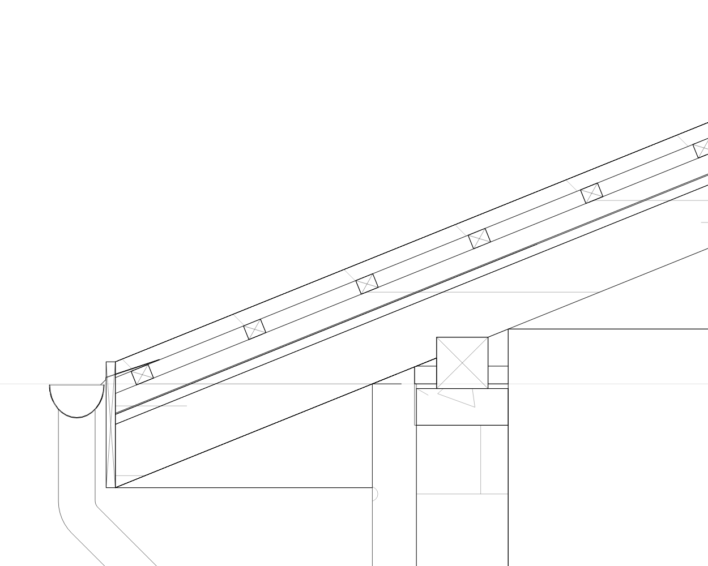

**Анализ на забиването и свръзките в разрезите — 28.10.2026**

Прегледан е приложеният `Architectural Project_ArchBimPackage.zip`: два етажа, пет стени, три плочи, четири покривни ската, два улука, две водосточни тръби и разрези A–A, B–B, C–C. Копие на оригиналния модел за повторение на проверките: [bim_package_sections_2026_10_28.json](../test/fixtures/bim_package_sections_2026_10_28.json). SHA-256 на `architectural.json`: `7e30ab9782a8a553ddc0580ed72cf2f19bad6eb1f2c9b6d2bb377500386936a5`.

По-долу е първоначалният анализ преди корекциите. Изпълнените промени, новите измервания и изображенията са описани в [отчета за реализацията](architect_sections_implementation_2026_10_28.md). Приложеният ZIP е запазен.

**1. Забиването е възпроизведено и локализирано**

Самото построяване на разреза приключва. Голямото блокиране настъпва след това, при подготовката на контурите за избор и редактиране:

`_nativeProjectionEditor → ArchitectBuildingSection.elementPaths → Path.combine(PathOperation.union, …)`.

В A–A първото обединяване на проектираното отводняване с действително срязания улук за `roof_366bb3f7_1793217634689829_9` отне **53,998 секунди**. След него започна аналогичната операция за втория скат. Изпълнението беше прекратено ръчно по време на втората операция; общото време за всички контури в този опит не е измерено. Това е продължително синхронно блокиране, а не установен безкраен цикъл или доказан недостиг на памет.

Извадка от синхронно записаната следа:

```text
22:26:29.388285 SECTION DONE Section A-A mode=full ms=1039
22:26:29.388285 ELEMENT PATHS START
22:26:30.079944 UNION START 79 roof_366bb3f7_1793217634689829_9 SlabMaterial.custom
22:27:24.078161 UNION DONE 79
22:27:24.079162 UNION START 80 roof_366bb3f7_1793217671909363_11 SlabMaterial.custom
```

Конкретните причини в кода са:

- В [architect_building_elevation.dart](../lib/src/features/architect/services/architect_building_elevation.dart) видимите повърхности на отводняването се обединяват за `faces`, но `elementPaths` натрупва множество отделни, припокриващи се полигони чрез `addPath`. Контурът за рисуване е изчистен, а контурът за избор остава значително по-сложен.
- В [architect_building_section.dart](../lib/src/features/architect/services/architect_building_section.dart) getter-ът `elementPaths` последователно обединява тези проекции със срязаните области чрез Flutter `Path.combine`. Това е измереното бавно място. И покривът, и улукът, и тръбата се натрупват под един `roof.id`.
- Getter-ът няма кеш. В [architect_workspace_screen.dart](../lib/src/features/architect/screens/architect_workspace_screen.dart) редакторът го извиква от `AnimatedBuilder`, който следи и viewport-а. Следователно местене и мащабиране могат да повторят тежката операция дори когато самата геометрия на разреза е кеширана.
- Дори при `details: false`, отводняването има 9 386 триъгълника. `_angles` добавя точките за точния отвор на воронката към всички пръстени на тръбата, а `_pipeRings` запазва плавните колена. Това усилва проблема, но измереното 54-секундно блокиране е в обединяването за избор.

Допълнителна проверка след уточнението, че приложението се използва на телефон от среден клас:

| Компонент | Първа стреха | Втора стреха |
| --- | ---: | ---: |
| Тръба с вътрешна/външна стена и долен ръб | 3 968 | 3 968 |
| Улук с отвор за тръбата | 738 | 712 |
| Общо | 4 706 | 4 680 |

За всяка тръба основните 16 точки по окръжността стават **64** заради напасването на отвора към кривия улук. Същите 64 точки се пренасят по всичките **16 пръстена** на тръбата, включително колената. Между пръстените се строят външна и вътрешна повърхност: `15 × 64 × 4 = 3 840` триъгълника плюс `128` за долния ръб. Около **85%** от триъгълниците на отводняването идват от двете тръби. Без записи за тръби един улук има 384 триъгълника.

Точността на връзката при воронката трябва да бъде локална. Разнасянето ѝ върху цялата тръба е излишен разход. За мобилната реализация оптимизирането на отводняването се повишава до **P0**, заедно с устойчивите и кеширани контури. Десктопният контролен експеримент не доказва приемлива работа на телефон; необходима е проверка на действителното устройство.

Измервания от Windows `flutter test`, без време за компилация, с предварително построена геометрия на отводняването:

| Режим | Общо триъгълници в контролния 3D mesh | A–A: построяване | B–B: построяване | C–C: построяване |
| --- | ---: | ---: | ---: | ---: |
| Без отводняване | 1 173 | 142 ms | 35 ms | 42 ms |
| Само улуци, без записи за тръби | 1 941 | 91 ms | 41 ms | 54 ms |
| Отводняване само в действителното сечение | 10 559* | 100 ms | 48 ms | 37 ms |
| Улуци и тръби, включително проекция | 10 559 | 1 076 ms | 912 ms | 286 ms |

\* Контролният mesh се строи независимо от видимостта на разреза. В режима „Само разрез“ проекцията изключва отводняването, а моделът запазва тръбите и отворите им.

Контролна замяна **само в диагностиката** на `Path.combine` със съществуващия `ArchitectMeshSection.combine` приключи цялата подготовка на контурите за **315 ms / 251 ms / 64 ms** за A–A / B–B / C–C. Този метод нормализира контурите чрез Clipper. Това потвърждава посоката за корекция; още не е внедрено решение и не е измерване на телефон.

Сегашният [section_3d_freeze_regression_test.dart](../test/features/architect/section_3d_freeze_regression_test.dart) минава и при наличието на дефекта: примерът му няма отводняване и не извиква `elementPaths`.

**2. Потвърдени неточности в свръзките**

| Място | Наблюдение и геометрична проверка | Причина и необходима корекция |
| --- | --- | --- |
| A–A, средна стена при билото | Двата ската създават практически еднакви мауерлати 14×14 cm и пояси 25×10 cm върху една опора. Добавената билова столица пресича мауерлата с около 0,01564 m² и бетонния пояс с около 0,01413 m² в разреза. | Опорите се генерират независимо за всеки скат. Обединяването почиства непрекъснатите слоеве, но не решава конфликтите между отделните конструктивни елементи. Нужни са една обща опора и съгласувани коти на пояс, мауерлат, столица и ребра. |
| C–C, съвпадение на разрезната линия с билото | Два ската дават едни и същи шест непрекъснати слоя върху участък около 0,60 m; има и застъпен дървен профил. Покритието се дублира върху около 0,02588 m², а зоната на ребрата — около 0,09173 m². | Разрез точно по общ ръб се приема едновременно за вътрешен на двата ската. Нужни са определен собственик на общата граница и нормализация на съвпадащите компоненти. Разрезната линия трябва да остане на зададеното място. |
| B–B, преход от страничен скат към бедро | Генерира се `ridgePurlin` при високия край на срязания скат, въпреки че разрезът не минава през същинското било. На общия чертеж се вижда изолиран дървен блок при прехода. | `buildSectionSlices` поставя столица по високия край на всеки интервал. Не проверява дали пресечният ръб е било, бедро или улама и как е ориентиран действителният елемент. |
| Стрехи в A–A/B–B/C–C | Има малко, но измеримо пресичане между челната дъска и капелника: около 0,0000326 m² на възел. Диагоналите се рисуват върху целия първоначален правоъгълник на дъската. | Всички отделни елементи трябва да минат през общото решаване на контакти. Щриховката/диагоналите трябва да бъдат ограничени от окончателната геометрия. |
| Разрез спрямо 3D | Детайлният 3D генератор използва собствена схема за мауерлат и столица. Например биловият профил използва размерите на мауерлата и не проверява `hasRidgePurlin` на мястото на създаването си. Разрезът използва отделните размери и флагове. | Нужен е общ набор от конструктивни компоненти с реални размери, ориентация и идентификатори, от който да се получават 3D и разрезите. |

Основни места за промяна: [architect_roof_geometry.dart](../lib/src/features/architect/services/architect_roof_geometry.dart), [architect_roof_junctions.dart](../lib/src/features/architect/services/architect_roof_junctions.dart), [architect_3d_builder.dart](../lib/src/features/architect/rendering/architect_3d_builder.dart) и [architect_building_sections_screen.dart](../lib/src/features/architect/widgets/architect_building_sections_screen.dart).

Улукът в разгледания детайл е кух и стои извън челната дъска. Не е установено, че предишният проблем с пресичане на улука през дъската е причината за сегашното забиване.

**3. Особености на модела, които влияят на автоматичните детайли**

- На кота 0,00 има три плочи с дебелина 16 cm и без зададен състав. `offset_298564cc_1793200572213621_10` и `slab_element_366bb3f7_1793218149972677_16` имат еднаква геометрия. Третата плоча е вложена в тях. Генераторът повтаря подовия пакет и основите за всяка плоча. Обединяването при рисуване скрива част от повторенията, но те остават в областите и асоциациите.
- Средната стена `wall_element_298564cc_1793205488556956_14` е записана с `location: exterior`, `loadBearing: false`, `height: 3.0`, `followStoreyHeight: true`. Генераторът я продължава нагоре и използва като покривна опора. Самата геометрия подсказва вътрешна стена, но предназначението ѝ не може да се установи само от този запис.
- [architect_section_junctions.dart](../lib/src/features/architect/services/architect_section_junctions.dart) създава основи по подразбиране за всяка съответна плоча. Това са производни детайли на разреза; в пакета няма отделно моделирани конструктивни основи с тези параметри.

Корекцията трябва да открива и показва такива конфликти, без автоматично изтриване на плочи или прекласифициране на стената. Общите производни детайли трябва да се генерират веднъж за физическия възел с проследими източници.

**4. План за корекция по приоритет**

1. **P0 — премахване на блокирането при отваряне и навигация.** Нормализиране и групово обединяване на контурите за всеки източник чрез устойчивия геометричен слой. Използване на изчистените силуети и за избора, като се запазват отворите, кухините и видимостта. Кеширане на готовите `elementPaths` за конкретната геометрична версия. Промяна на viewport-а не трябва да строи или обединява геометрия. Отделни проверки за избиране на покрив, улук и тръба и за асоциациите към модела.
2. **P1 — общи покривни възли и конструктивни компоненти.** Топология на било/бедра/улами/стрехи и действителни опорни линии по ядрата на стените. Един идентификатор за общия пояс/мауерлат/столица, дори когато се обслужват два ската. Решаване на котите, допирите и необходимите изрязвания преди представянето. Премахване на правилото „висок край на интервала = билова столица“. Същите компоненти да се използват в 3D, действителните сечения и видимите проекции.
3. **P1 — еднозначно сечение по обща граница.** Собственост на съвпадащите слоеве и компоненти при C–C и при разрез по връх/бедро. Единна система от допуски, значително под дебелината на тънката ламарина; отделна проверка за мембрани. Без изместване на линията, за да се избегне специалният случай.
4. **P1 — окончателно почистване на стрехите и щриховките.** Взаимно изрязване на дъска, капелник и покривни слоеве според физическия контакт. Диагонали и материални щриховки само в окончателните области. Тънки неутрални линии, бяла основа и четим черно-бял печат.
5. **P0 за телефон — ограничаване на изчислителната цена на отводняването, заедно със стъпка 1.** Допълнителните точки на воронката да останат локални до връзката с улука. За проекция да се ползва точният външен силует; за действително сечение — кухият материален профил. Да се запазят точните колена, трасета и скриване зад стени. След измерване — изнасяне на тежките числови операции в работен isolate с преносими координатни данни, кеш по геометрична версия и отхвърляне на остарели резултати. Само обвиване на сегашния синхронен код във `Future` няма да освободи основната нишка.
6. **P2 — контрол на съвпадащи елементи и автоматични основи.** Откриване на еднаквите/застъпени плочи и противоречивите роли на стените. Еднократно генериране на общите възли, ясно съответствие с параметрите на модела и съгласуване между изгледите. Всички евентуални нови съобщения, подсказки и настройки да са в ARB за bg/en.

Първата промяна може да се внедри отделно и да премахне блокирането. Следващите промени трябва да коригират самата геометрия на възлите, така че екранът, 3D и публикуваните чертежи да показват един и същи модел.

**5. Проверки за приемане**

- Реалният пакет: A–A/B–B/C–C, първо отваряне, повторно отваряне, избор, pan/zoom, обръщане на разреза, дълбочина и всички режими на видимост. Да се измерват и `build`, и `elementPaths`, и цялото отваряне през workspace редактора. Навигация по непроменен модел трябва да използва вече готовите контури.
- Отделен процес с външен времеви лимит за регресията на блокирането: таймер в същия isolate не може да прекъсне блокирала синхронна native операция. Да се включат и двата профила на улука, тръба през/зад разреза, колена, повече тръби и краища на улука.
- Геометрични проверки за площ/обем на пресичане между различни материали и за общи компоненти, създадени повече от веднъж. Да се проверяват и отделните елементи помежду им, включително столица–пояс, а не само слоевете спрямо опорите.
- Разрез точно по било/бедро, непосредствено от двете му страни, през връх и през стена по дължина. Стабилни резултати при размяна на реда на скатовете.
- Визуална проверка на възлите при 1:5/1:10 и общите разрези при 1:50/1:100; сравнение с 3D и векторното публикуване. Няма двойни контури, пресичащи щриховки, висящи столици и стърчащи участъци от стени.
- Запазване/отваряне на стария JSON, избор на първоначалните елементи, Undo/Redo и редакция на параметрите. Финална проверка и на реално мобилно устройство.

**6. Повторение и доказателства**

[Диагностичният инструмент](../tool/diagnostics/architect_section_package_audit_test.dart) записва времена, области, пресичания и видове покривни елементи в `build/section-audit-2026-10-28/`. Режимът `robust` е контролен експеримент, който не променя приложението:

```powershell
flutter test --no-pub tool/diagnostics/architect_section_package_audit_test.dart --reporter expanded --dart-define=AUDIT_PATH_MODE=robust
```

За повторение на бавната оригинална последователност само в A–A:

```powershell
flutter test --no-pub tool/diagnostics/architect_section_package_audit_test.dart --reporter expanded --dart-define=AUDIT_MODE=full --dart-define=AUDIT_SECTION=0 --dart-define=AUDIT_PATH_MODE=raw
```

`raw` записва начало/край на всяко обединяване в `trace.log` и може да блокира десетки секунди. За нови изображения се добавя `--dart-define=AUDIT_CAPTURE=true`. По подразбиране инструментът пропуска бавните обединявания и не създава изображения.

Проверени са 12 диагностични комбинации и трите съществуващи теста за замръзване — **15 успешни проверки**. Статичният анализ на диагностичния инструмент е чист. Успехът на контролния експеримент не означава, че приложението вече е поправено. Анализът на взаимните пресичания използва площи на сеченията с допуск и е допълнен с визуален преглед; бъдещата реализация изисква и проверка на действителните 3D обеми.

Изображенията по-долу са от реалния Flutter painter с текущата продуктова геометрия:

| A–A | B–B | C–C |
| --- | --- | --- |
| [Общ разрез](images/architect_section_audit_2026_10_28_0.png) | [Общ разрез](images/architect_section_audit_2026_10_28_1.png) | [Общ разрез](images/architect_section_audit_2026_10_28_2.png) |






