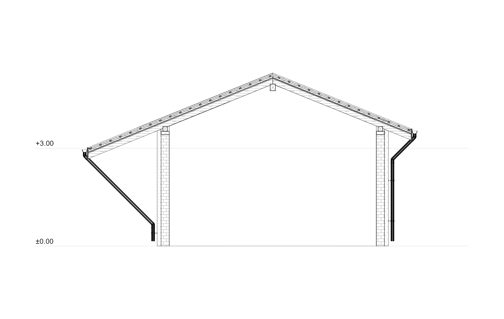
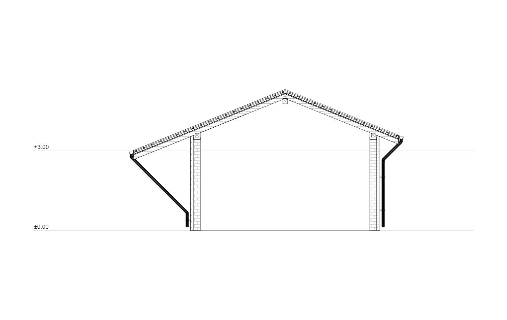
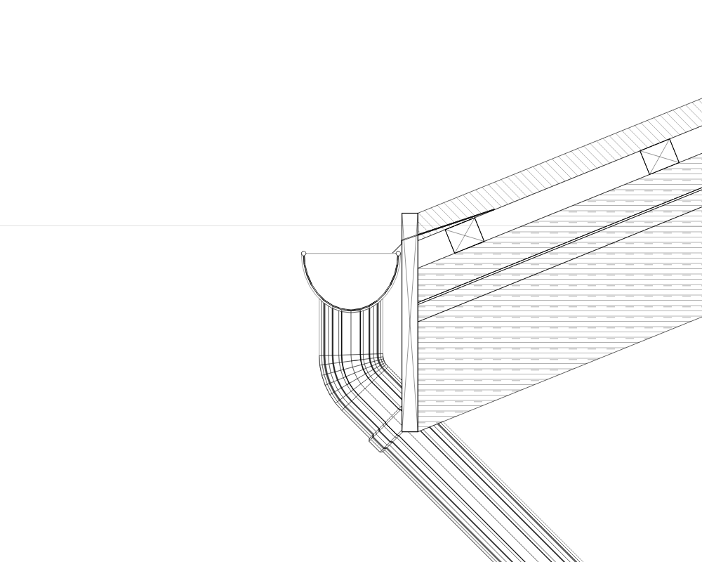

# Поправки на разрезите B–B и C–C от прикачените пакети

Източник: двата прикачени пакета `Architectural Project_ArchBimPackage.zip`, 25.10.2026. Първият съдържа C–C, а вторият — реалните B–B и C–C. И двата модела са запазени като регресионни фикстури.

## Причини и корекции

- **Липсваща тръба:** тя е извън равнината на C–C, а празните настройки за видимост досега означаваха „Само разрез“. Подразбирането вече е „Разрез и изглед“. Изрично зададени „Само разрез“ и „Скрито“, дълбочината на гледане и скриването зад действителни препятствия се запазват. Проектираната тръба не се щрихова като срязан материал.
- **Губещ се улук:** закръгляването на краищата на отсечките поставяше практически съвпадащи върхове в различни клетки. Контурът на тънкия метал оставаше отворен и сечението се пропускаше. Върховете вече се съединяват по действително разстояние в съседни клетки; за ламариненото отводняване допускът е 0.01 mm, значително под дебелината на материала. И двата улука от C–C вече имат действително кухо сечение.
- **Неправилна връзка при стрехата:** задният борд на улука пресичаше челната дъска, а капелникът влизаше в стената на канала. Улукът вече е извън дъската, включително завалцования борд. Височината му следва долната страна на действителното покритие. Капелникът е с дебелина 1 mm и късо отвеждане над канала. Геометричната проверка потвърждава липса на пресичане с дъската и канала.
- **Еднакви щриховки:** общият диагонален заместител е премахнат. Зидарията получава тухлени редове, бетонът — агрегати, дървото — надлъжна шарка или диагонали в напречно сечение, изолациите — отделни материални шарки. Тънките мембрани и кухите метални профили се четат чрез контурите си. Печатът и екранът използват едни и същи векторни щриховки, отделени от контурите като `sectionHatch`.
- **Показател Eaves:** запазеният `eavesOverhang` е номинален параметър за създаване и опорна кота; той не измерва отстоянието на текущия контур от фасадата. За съществуващи покриви подвеждащият бърз показател и полето в „Форма“ са премахнати. Параметърът остава в настройките за нов покрив. Съществуващият контур се редактира в плана.

## Разменени ляво и дясно

Причината е смесване на станцията по подредената разрезна линия с хоризонталната координата на изгледа. В плана +Y е надолу; при запазените стрелки екранното „надясно“ трябва да е противоположно на оста на станциите.

Изгледът вече използва `x = дължина − станция`. Позициите и стрелките на разрезите, сградата и старите записи остават на място. Преобразуват се срязаните материали, видимата проекция, контурите за избор и редакция, схемите с изнесени слоеве и ръчните размери, коти и бележки. Текстът остава четим. Редактираните данни се преобразуват обратно към запазената координатна система; Undo и старите JSON записи запазват асоциациите си. Същата рамка се използва при публикуване.

И двата действителни разреза от втория пакет са проверени: южната стреха и нейната тръба вече са вдясно, както изисква посоката на гледане. Проверени са и изборът на двата ската и техните профили.

## Проверка

Регресията използва `test/fixtures/bim_package_section_cc_2026_10_25.json` и `test/fixtures/bim_package_sections_bb_cc_2026_10_25.json`.

- Показване на реалната тръба в C–C и в нов разрез; изключване на проекцията при изричен режим „Само разрез“.
- Двата улука имат кух профил с реални размери 15×9 cm и завалцовани бордове.
- Нулево геометрично пресичане между улука и челната дъска/капелника.
- Различни материални щриховки и липса на щриховка във въздуха на канала.
- Общите проверки обхващат сечения, отводняване, UI bg/en, публикуване, опори и стълби.
- Отделно са проверени ръчно чертане в разреза, размери и бележки, преобразуване към стария запис, Undo/Redo и повторно обръщане на разреза.
- Финалният целеви пакет е с 33 успешни теста. Статичният анализ на 22 променени файла е чист; `git diff --check` минава.

Реални изображения от общия Flutter painter, без рисувана илюстрация:

