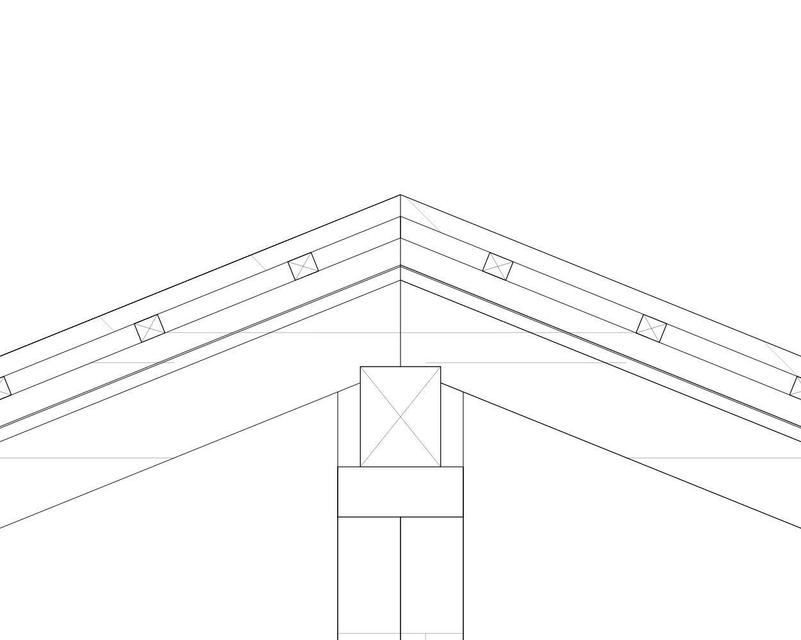
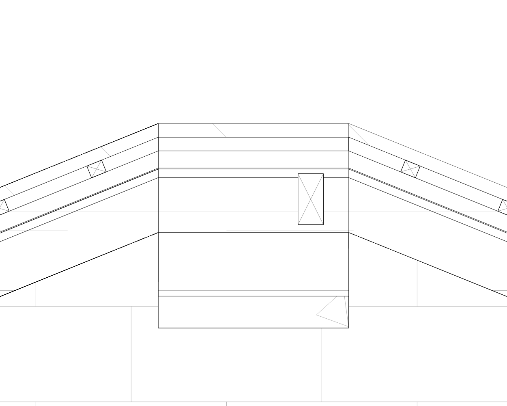
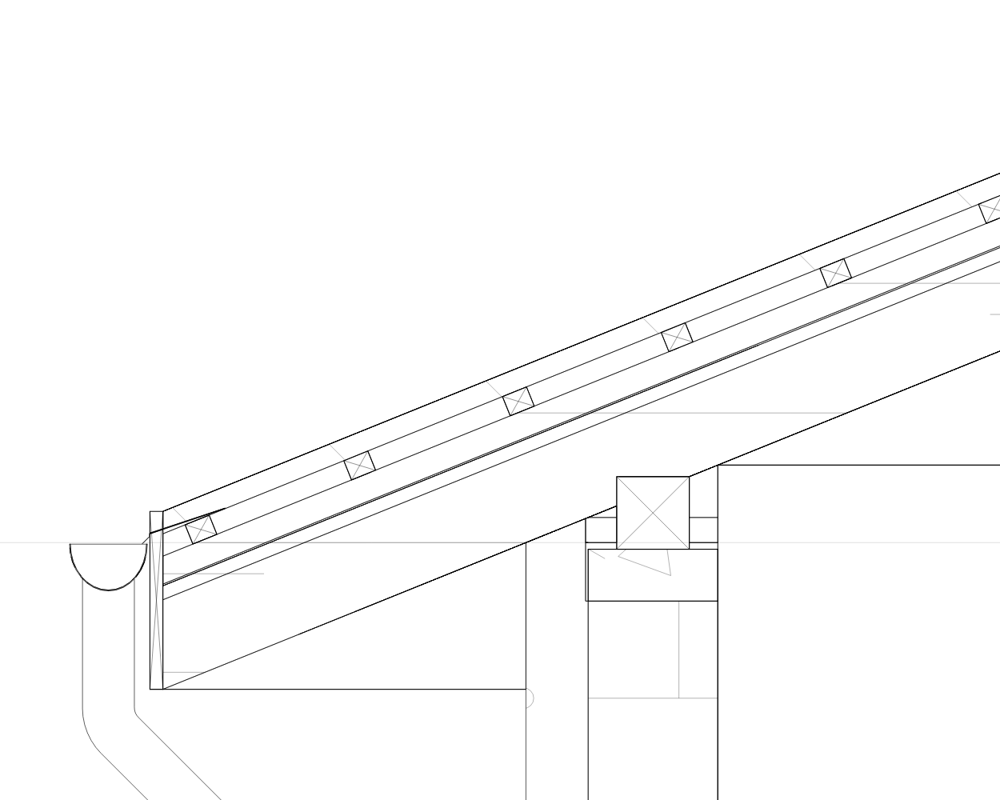

**Корекции на разрезите и отводняването — 28.10.2026**

Изпълнени са корекциите на блокирането и потвърдените покривни свръзки от [анализа на приложения пакет](architect_section_audit_plan_2026_10_28.md). Оригиналният ZIP и регресионният JSON са запазени.

**Отваряне и навигация**

- Контурите за избор се нормализират, обединяват групово и кешират. Видимите фасети на тръбите вече не се подават като хиляди застъпени полигони към native `Path.combine`.
- Изчисляването на видимостта и скритите линии при интерактивен разрез работи в отделен isolate. Между нишките се предават координати и идентификатори; Flutter `Path` и рисуването остават в основната нишка.
- В основния workspace и екрана за разрези се показва състояние на изчисляване. Има локализирано съобщение за грешка и повторение за bg/en. Навигацията не чака синхронното завършване на алгоритъма.
- Изпълнява се една активна заявка и се пази само последната чакаща. Остарял резултат не може да замени нов модел или друг разрез. Изборът и редакторът се запазват при обновяване на геометрията.
- Стъпаловидните разрези използват групово обединяване на частите и в двата режима. Проверени са съответствието между фоновото изчисляване и публикуването, обратна посока и ограничена дълбочина.

Основни файлове: [числов алгоритъм за видимост](../lib/src/features/architect/rendering/architect_projection_visibility.dart), [контролер на заявките](../lib/src/features/architect/services/architect_projection_loader.dart), [генератор на разрези](../lib/src/features/architect/services/architect_building_section.dart).

**Геометрия на отводняването**

64-те точки за точния отвор към кривия улук остават в първия пръстен на тръбата. Следващите пръстени използват редовния профил с 16 точки. Преходът се триангулира между различните броеве върхове, без отворени ръбове и T-образни съединения. Запазени са вътрешната стена, отворът, долният ръб, колената и трасето.

| Показател в реалния пакет | Преди | След |
| --- | ---: | ---: |
| Отводняване, триъгълници | 9 386 | 3 626 |
| Контури за избор в A–A | 53,998 s само за първото тежко обединяване | 18 ms за цялата карта |
| Контури за избор в B–B / C–C | Не е измерено пълното старо обединяване | 15 / 14 ms |
| Повторно използване при pan/zoom | Повторно обединяване | Същата кеширана карта |

Намалението на геометрията на отводняването е **61,4%**. Времето е от Windows Flutter тестове, с предварително построен контролен mesh; не е измерване на физически телефон. В отделни регресионни изпълнения подготовката на контурите е 6–14 ms. В интерактивния път тежката видимост се обработва във фоновия isolate.

**Покривни възли**

- Биловата столица е общ физически компонент с действителни размери, дължина и ориентация, използван в 3D и сеченията. Вече не се създава столица при произволен висок край на срязания скат.
- A–A: една столица върху общ пояс заменя застъпените мауерлати и пояси. Зидарията се ограничава до долната страна на опората.
- B–B: премахнат е погрешният дървен блок при бедрото.
- C–C: слоевете по общия ръб имат еднозначен собственик. Надлъжното сечение на столицата показва реалната ѝ дължина, без символ за напречно срязано дърво.
- Челната дъска и капелникът са изрязани по материалния контакт. Диагоналите на дървото се ограничават от окончателния контур.
- Ребрата в подробния 3D модел получават действителни изрязвания при биловата столица. Проверено е, че дървените обеми не се застъпват във възела.

При проверката на трите разреза няма пресичания над 1 mm² между покривните области. Останалите застъпени области от диагностика са свързани с трите входни плочи. Плочите и предназначението на средната стена не са променяни автоматично. Общата диагностика на такива конфликти в модела остава отделна задача от P2 в първоначалния план.

Основни файлове: [обща билова столица и опори](../lib/src/features/architect/services/architect_roof_ridge_beams.dart), [покривни сечения](../lib/src/features/architect/services/architect_roof_geometry.dart), [3D генератор](../lib/src/features/architect/rendering/architect_3d_builder.dart).

**Проверка и повторение**

Новите регресии проверяват реалния пакет, кеширането при навигация на телефонен размер 390×844, затворената мрежа и кухината на тръбата, равенството на фоновия и синхронния резултат, стъпаловидни разрези, остарели заявки, повторение след грешка, биловите контакти и стабилност при пренареждане на скатовете. Съществуващите UI тестове изчакват реалния worker вместо само фалшивия часовник на Flutter тестовете.

Финалният целеви пакет е с **182 успешни теста** за разрези, покриви, отводняване, фасади, отвори, панели, свръзки, UI и публикуване. Статичният анализ на 25 променени/добавени Dart файла е чист; `git diff --check` минава.

За повторение на измерванията и изображенията с продуктовия код:

```powershell
flutter test --no-pub tool/diagnostics/architect_section_package_audit_test.dart --reporter expanded --dart-define=AUDIT_MODE=full --dart-define=AUDIT_ALL_SECTIONS=true --dart-define=AUDIT_PATH_MODE=production --dart-define=AUDIT_CAPTURE=true --dart-define=AUDIT_OUTPUT=build/section-audit-2026-10-28/after
```

Физически телефон не е използван при тази проверка. Измерване на конкретното устройство остава необходимо за оценка на действителното време за отваряне и паметта.

| A–A | B–B | C–C |
| --- | --- | --- |
| [След корекциите](images/architect_sections_fixed_2026_10_28_0.png) | [След корекциите](images/architect_sections_fixed_2026_10_28_1.png) | [След корекциите](images/architect_sections_fixed_2026_10_28_2.png) |






