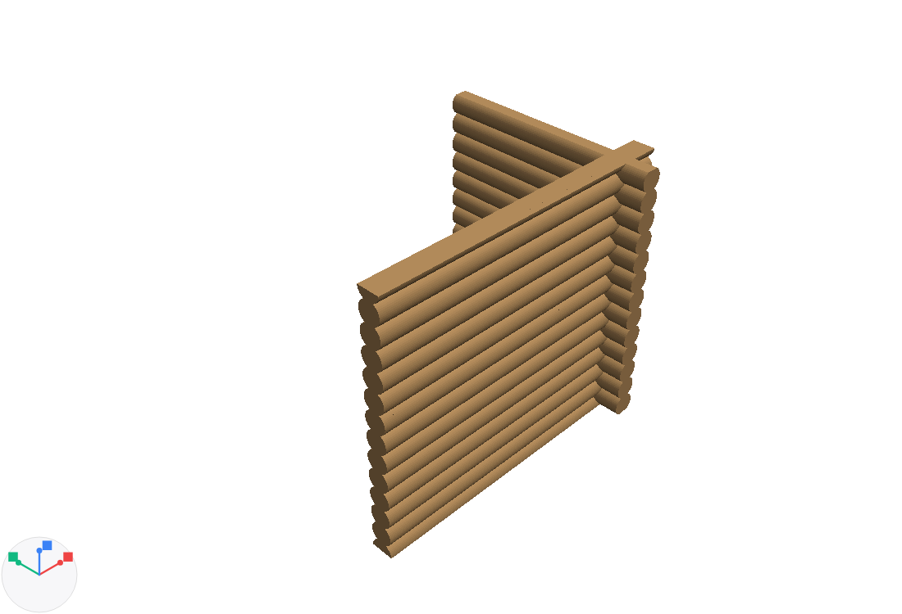
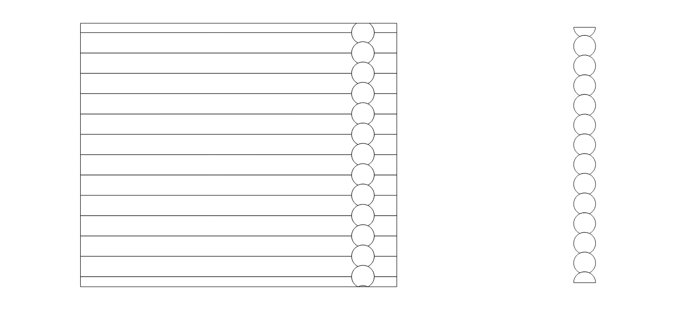
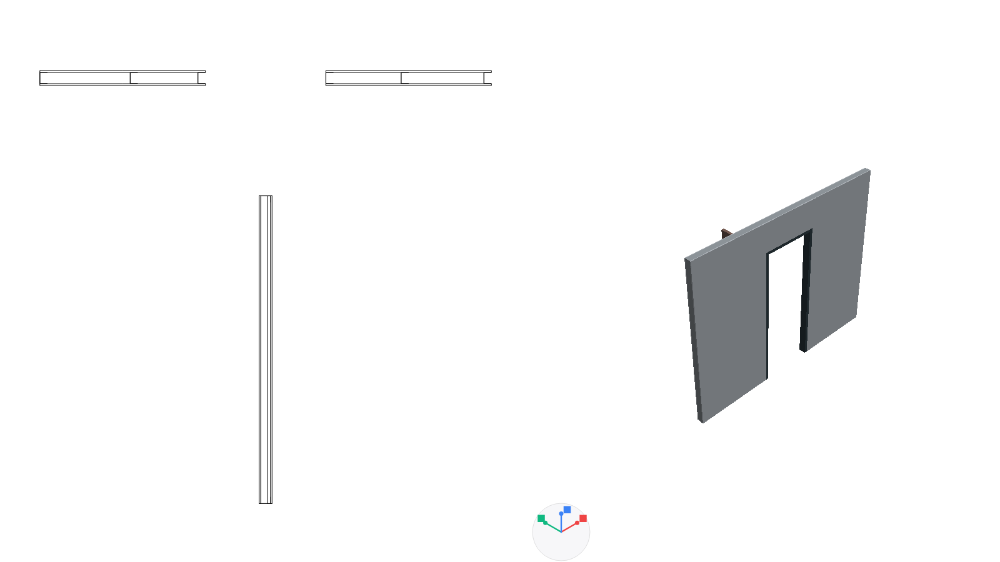
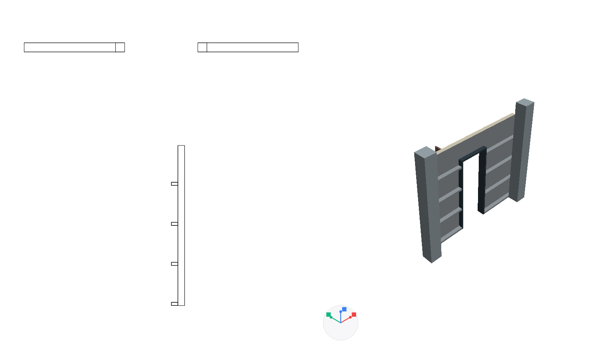

# Специални стенни системи — първа реализация

26.10.2026 г.

## Достъп в приложението

От управлението на стенните типове изберете **Нов тип** и съответния шаблон. В редактора на състава има и избор **Система**: **Трупи**, **Гипсокартон**, **Термопанели**. Новите типове не подменят петте досегашни начални типа на старите проекти.

Настройките и имената на системите са в ARB за български и английски. Потребителските имена на типове и означенията на колоните се запазват.

## Реализирано поведение

| Система | Начален шаблон | Геометрия и настройки |
| --- | --- | --- |
| Кръгли трупи | Ø240 mm, застъпване 10%, издаване 1 диаметър | Дебелината е диаметърът. Външният профил остава кръгъл, независимо от височината на стената. Жлебът и ъгловите засечки изваждат контактните обеми. |
| Гипсокартон | 12.5 + 75 + 12.5 mm | Отделни плоскости, C-стойки, U-водачи, рамки около отвори, 50 mm вата в кухината. Стъпка, ширина, метал и вата се редактират. |
| Термопанели | 100 mm панел + 100 mm подконструкция | Две стоманени обшивки и PIR, отделни кухи профили, панелен модул, хоризонтално/вертикално полагане, монтаж пред или между колони. Началният профил е 50×100×3 mm. |

### Трупи

- Височина на реда: `h = D × (1 − p/100)`. Съседните перпендикулярни стени се разминават с `h/2`. При D=240 mm и p=10% това е h=216 mm и разминаване 108 mm.
- Издаването започва от външното номинално лице на перпендикулярната стена: при стандартния ъгъл физическият край е на `D/2 + D` от монтажното пресичане. Монтажните точки не се местят заради издаването.
- L/T/X-възлите са със засечки. При вътрешно разделяне на една права стена няма нови издавания.
- Началният и последният ред се отрязват по зададените долна/горна кота. Трупите не се разтягат вертикално, за да изпълнят височината.
- Има обсада на отвори, ширина на обсадата и задаваемо свободно място за слягане над нея. Началната стойност за слягане е 0 и се задава от проектанта.
- Автоматичният детектор и генерирането на командите за изрязване разпознават преднамереното издаване. Неправилни монтажни краища продължават да се откриват.
- Свързани трупени стени с несъвместим диаметър, стъпка, основа или неправ ъгъл се отхвърлят при редактиране. Промяната на типа на целия комплект позволява обща промяна на диаметъра.
- Добавен е покривен шаблон **Дървен · трупи**, базиран на съществуващия дървен скатен покрив: без бетонен пояс и с опиране върху дървената столица. Стената се отрязва по действителните долни повърхности.

### Термопанели и колони

- Панелната дебелина и дълбочината на подконструкцията се събират веднъж. Профилната кухина остава празна.
- При ново поле близките колони се свързват по устойчиви ID. От **Свойства → Опори към колони** могат да се изберат конкретни колони и монтажен отстъп.
- **Пред колоните** поставя подконструкцията пред външните лица. Положително отстояние създава междина и общи L-планки до действителните лица.
- **Между колоните** определя началото и края по вътрешните лица на крайните колони; външното лице на панелната система се подравнява с колоните.
- Размерът и завъртането на колоните участват в изчисляването на лицата. Преместването на опора актуализира зависимото поле без двойно преместване при запис на командата.
- При хоризонтални панели вертикалните профили следват свързаните колони. При вертикални панели профилите са хоризонтални със зададената стъпка.
- Изтриването на колона запазва липсващата връзка и показва съобщение. Тя може да се премахне с **Премахни липсващите**, след което да се избере заместител. Няма мълчаливо прикрепване към друга колона.

## План, разрез, фасада и 3D

Планът реже действителните компоненти на котата на сечението. Разрезът използва същите затворени тела; запазва кухините на стоманените профили и свободното място над обсадата. Отворите премахват всички засегнати компоненти.

Контактите с плочи, колони, обикновени стени и покриви премахват пресичащите се обеми. При фасадите видимите повърхности се обединяват по конструктивен компонент, за да не се публикуват ръбовете на триангулацията. Проекционни шевове под 0.01 mm се заваряват при построяването на контурите.

За 3D вътрешните контактни повърхности се премахват отделно от затворените тела за разрезите. Геометрията на специалните компоненти се кешира за непроменен проект и етаж. Контролният трупен ъгъл 3×2 m, висок 2.8 m, дава приблизително 19 320 триъгълника и 27 фасадни контура. Това е малък контролен пример; производителност при голяма сграда не е измервана.

Изображенията са от действителните модели/генератори. 3D кадрите използват наличния native depth backend на приложението; тестът допуска и стандартния Canvas backend, когато native backend липсва.

## Проверки

- **34 нови проверки — всички успешни**, в `architect_special_wall_systems_test.dart` и `architect_special_wall_ui_test.dart`: геометрия, кухи профили, диаметър, стъпка, L/T/X, обърнати посоки, реални сечения, отвори/обсада/слягане, покривна опора, сериализация, състав 100+100, свързани колони, изтрита опора, автоматично изрязване, разделяне, групово местене и Undo/Redo.
- Интерфейсът е проверен на 320 px в светла тема и на 390 px в тъмна тема, на български и английски, за трите системи. Проверява се и записът на редактираните параметри.
- Последен пълен регресионен пакет преди окончателното обединяване на контактните лица: 386 успешни проверки и 15 неуспешни. Всичките 15 са възпроизведени със същите тестове върху оригиналния HEAD `8854cb232fc084ee7092327c406de6e1ecc3dcde` в изолирано копие: няма нови имена на неуспешни тестове спрямо HEAD.
- Финално повторение на 27-те файла, възстановими от подробния лог: 250 успешни и същите 15 неуспешни проверки. Допълнително се изпълняват двата нови тестови файла след последната UI поправка.
- Предварително съществуващите неуспехи са в оси/редактиране на проекции, жестове, бърза дебелина, стенни връзки/състави и форматиране `3.00`/`3`. Не са променяни несвързани функционалности за прикриване на тези резултати.
- Статичен анализ на целия архитектурен модул и двата нови тестови файла: **No issues found**. `git diff --check`: без грешки. PNG проверките показват контури за печат; не е добавян или сертифициран нов производствен PDF/DXF експорт.

## Оставащи специализирани варианти

- Трупи с различни/естествени диаметри и неправоъгълни сглобки; текущата система е за прави стени и еднакви диаметри в свързан възел.
- Производствени профили на жлебове, заводски сглобки, конкретни обсади, крепежи и плъзгащи покривни опори за слягане. Сегашните профили и планки са общ геометричен модел, без изчисляване на носимоспособност или автоматичен избор на анкери.
- Разширени каталози на гипсокартонени системи и производствени детайли за крайни/деформационни връзки.
- Покривът от термопанели е реализиран впоследствие като отделен обхват: [настройки, изображения и ограничения](architect_panel_roof_implementation_2026_10_26.md).
