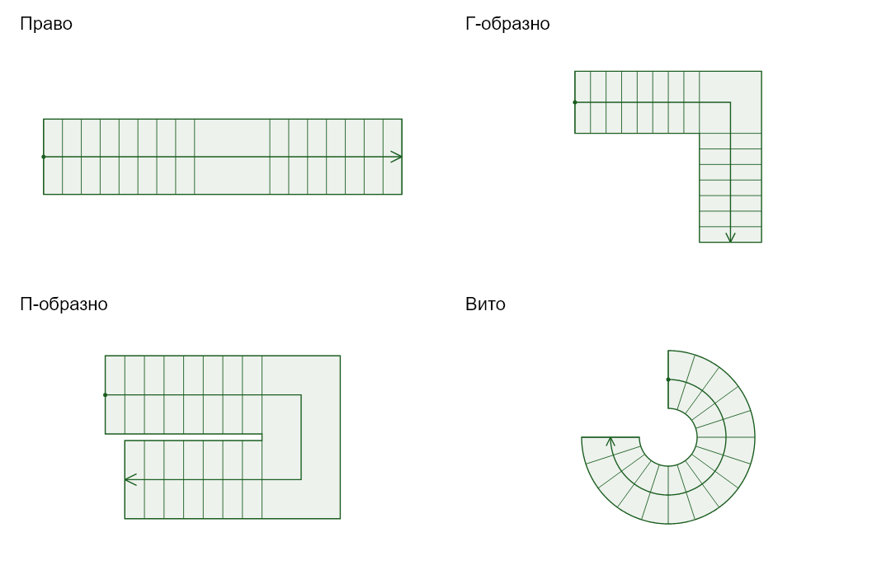
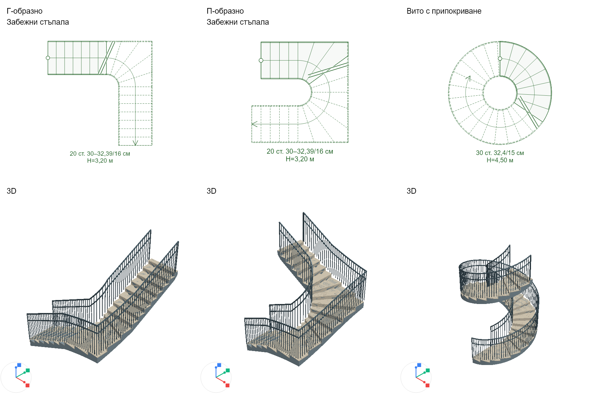
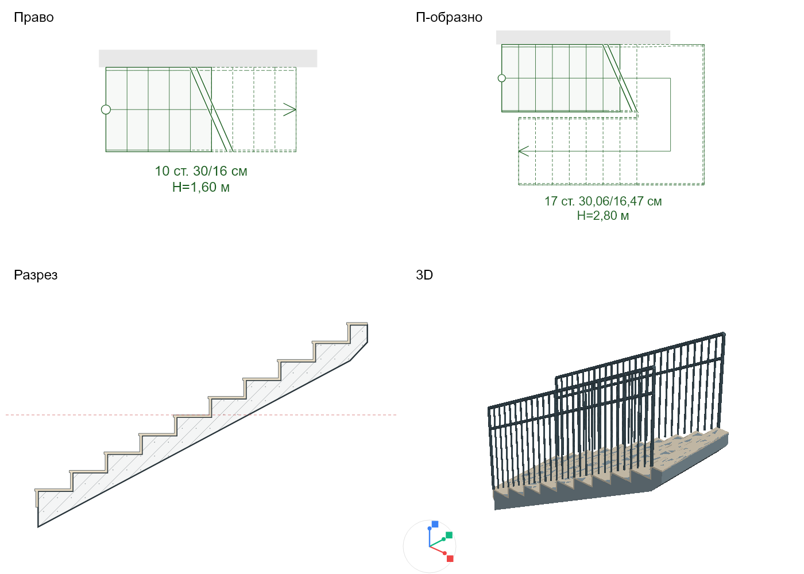

# Стълби в архитектурния редактор

Нормативен профил: `BG-2025.1`. Проверени официални източници на 16.10.2026 г.
Версията означава конкретния реализиран набор проверки, а не удостоверяване на
целия проект или автоматично следене на бъдещи изменения на законодателството.

## Работа с инструмента

1. Избира се форма: право, Г-образно, П-образно, вито или вито с припокриване.
2. Посочват се първият подстъп и посоката на изкачване. Второто посочване определя
   ориентацията; дължината се изчислява от стъпката и броя подстъпи.
3. Височината идва от котите на готовите подове. Когато няма моделиран горен етаж,
   се използва височината на началния етаж. В „Свойства“ се избира конкретен горен
   етаж или ръчна височина.
4. Броят подстъпи и стъпката се подбират автоматично. По всяко рамо с N подстъпа
   има N−1 стъпки; площадките не добавят подстъпи. Целочисленото разпределение се
   проверява след подбора, включително случаите близо до граничната височина.
5. Г-/П-образните стълби са с площадки по подразбиране. „Забежни стъпала“ заменя
   площадката с радиални стъпала в правоъгълен външен контур и светъл, заоблен
   вътрешен отвор. Разпределяне на забежните стъпала в съседните прави участъци
   по двуточков/балансиран метод не е реализирано.

Основните настройки са форма, светла широчина и връзка с етажите. Размерите,
предназначението и евакуационният режим се редактират в „Свойства“. Подробностите
и източниците са в разгъваеми секции. Новите продуктови текстове са в BG/EN ARB.

## Източници и обхват

- [МВР: Наредба Iз-1971, консолидиран текст 2025](https://mvr.bg/upload/286736/Naredba%20Iz-1971_2025_1.pdf).
- [Държавен вестник: Наредба РД-02-20-2/2021](https://dv.parliament.bg/DVWeb/showMaterialDV.jsp?idMat=155689).
- [МРРБ: публикация с допълнението от 2025 г.](https://www.mrrb.bg/bg/naredba-rd-02-20-2-ot-26-yanuari-2021-g-za-opredelyane-na-iziskvaniyata-za-dostupnost-i-universalen-dizajn-na-elementite-na-dostupnata-sreda-v-urbaniziranata-teritoriya-i-na-sgradite-i-suorujeniyata-kakto-i-tehnicheskite-87940/).

| Обхват | Автоматична геометрична проверка | Основание |
|---|---|---|
| Нови общи жилищни/обществени стълби | Рамо ≥1,20 m; h≤0,17 m; b=0,28–0,35 m; рамо до 2,50 m височина, след което площадка ≥1,20 m | РД-02-20-2, чл. 55(1) |
| Посочените обществени сгради с масов достъп над 200 души | Рамо ≥1,60 m | чл. 55(1)1 |
| Нов градски маршрут | Рамо ≥1,20 m; h≤0,15 m; b≥0,32 m; рамо до 1,20 m височина; площадка ≥1,50 m | чл. 18(1) |
| Вътрешен евакуационен път | h≤0,22 m; b≥0,25 m и h/b≤1/1,5 за правите рамена; площадка поне колкото рамото; минимум 3 подстъпа в група | Iз-1971, чл. 47(4), 45(8), 54(3) |
| Вито, евакуация 16–50 души | b≥0,23 m на 0,30 m от вътрешния ограничаващ ръб; рамо ≥1,20 m | чл. 52(1) |
| Вито, евакуация над 50 души | Вътрешен диаметър ≥0,90 m; b≥0,23 m при тесния край; рамо ≥1,50 m | чл. 52(2) |
| Вито, до 15 души | Не се пренасят автоматично ограниченията от чл. 52(1) | чл. 52(3) |
| Неправоъгълни стъпала в невито стълбище, евакуация 16–50 души | b≥0,23 m на 0,30 m от тесния край/ограничаващата проекция на парапета; рамо ≥1,20 m | чл. 52(4) |

За радиалните стъпала се използва консервативното хордово разстояние
`b(r)=2r·sin(Δφ/2)`, което е по-малко от съответната дъга. Вътрешният радиус е
светъл, от ограничаващия ръб/проекция на парапета. Широчината също е светла.

`2h+b` с цел 0,63 m и препоръчителен интервал 0,60–0,64 m е проектен критерий за
удобство. Не е представен като отделно потвърдено законово изискване.

## Статуси и ограничения

Проверките разграничават изпълнена геометрия, нарушение, препоръка и непроверено
изискване. Познато нарушение блокира обичайното запазване; изрично избрана
„Чернова“ позволява запазване и се показва в червено. Промяна на коти, която
нарушава ръчните ограничения, или изтриване на свързания горен етаж също води до
чернова. Една промяна и преизчисляването ѝ се отменят заедно.

Не се издава общ резултат „напълно нормативно“. Непроверени остават общият просвет и
отворът в плочата, парапетите/ръкохватките, настилките, тактилните ивици, челата,
пожарният клас, капацитетът и целият евакуационен маршрут. За витите стълби
приложимостта на достъпността остава за проектна проверка; известната необходимост
от площадка според височината все пак се проверява.

При „Вито с припокриване“ се проверява отделно просветът между собствените
застъпващи се части. Това не проверява отвора в плочата или други елементи на
сградата.

## Забежни стъпала и припокриване

В Г-/П-образните стълби превключвателят „Забежни стъпала“ е в основните свойства.
Автоматично се подбират броят стъпала на 90° и светлият вътрешен радиус. По
подразбиране едно стъпало преминава през външния ъгъл: броят на 90° е нечетен.
В „Размери → В ъгъла“ може да се избере „Чело“ — четен брой, с чело по
ъглополовящата. И двата варианта са познати геометрични решения; няма заложена
универсална забрана на чело в ъгъла. Светлият вътрешен радиус предотвратява
събирането на всички тесни краища в една точка. Поне една права стъпка се
запазва преди и след завоя. П-/Г-стълбата със забежни стъпала се отчита като едно
непрекъснато рамо: не може да замести площадката, изисквана по височина.

При автоматичния подбор 23 cm на 30 cm е проектна цел за всички режими;
нарушаването ѝ при ръчни размери е нормативна грешка само в реализирания обхват
на чл. 52(4), а извън него — препоръка. Минималният тесен край 5 cm е проектна
препоръка от ръководството на BWF, а не българска норма. За над 50 евакуирани по
невито стълбище с неправоъгълни стъпала се изисква отделна проверка на обхвата;
не се пренася автоматично правилото за вътрешния кръг на витите стълби.

„Вито с припокриване“ означава повече от 360° (по подразбиране 375°, до 1080°).
Триизмерните тела и парапетите продължават по височина през оборотите; плановият
контур е пръстен, без самопресичащ се многократен контур. В 2D части над среза,
които съвпадат с по-ниски показани стъпала, се скриват за четимост. Просветът до
бетонния под на следващия оборот се оценява консервативно с
`(floor(8·2π/Δφ)/8 − 1)·h − tбетон − tнастилка`. Закръглянето надолу до долната
граница на ъгловия сегмент не завишава просвета на триангулираната плоча.
Неположителна консервативна граница на просвета е грешка дори в
„Само геометрия“. За обхвата на чл. 55 се проверяват 2,10 m; за частни стълби
това е проектна препоръка. Отворът в плочата остава отделна проектна проверка.

Бетонната плоча през забежния завой е непрекъсната; настилката и издаденият нос
са отделни тела. Опиранията, армирането, дебелината по конструктивно изчисление и
възлите с плочите не се изчисляват от инструмента. Разположението на челото в
ъгъла само по себе си не решава тези въпроси.

Геометрични/конструктивни справки:
- [Graphisoft: варианти с чело или стъпало в средата на завоя](https://help.graphisoft.com/AC/21/INT/AC21Help/900_ExtraTopics/900_ExtraTopics-1.htm).
- [BWF: Design Guide 1, раздел 2, разчертаване и опиране на забежни стъпала](https://www.bwf.org.uk/publication/bwf-stair-design-guide-domestic-timber-stairs/).

Тези справки обосновават избора на геометрично решение; чуждите размерни правила
не се представят като българска нормативна база.

Градският маршрут не е профил за външна открита евакуационна стълба по чл. 51.
Не са включени специалните изключения за съществуващи сгради, всички изисквания
за вътрешни стълби в жилища, производствени/служебни стълби и специфични сгради.
При тези случаи се отбелязва непълен обхват, вместо да се предполага съответствие.

## Данни и визуализация

Профилът, версията, размерите, ръчните ограничения и етажната връзка се пазят във
файла на проекта. Старите схематични стълби запазват геометрията си и се превръщат
само чрез изрично преизчисляване. Неизвестна версия на нормите не дава нормативен
резултат „изпълнено“.

Прегледът преди поставяне, чертежът, изборът, прихващането, обхватът на изгледа и
3D ползват обща геометрия. Бетонната плоча, настилката и издаденият ръб са отделни
тела в 3D и вертикалния разрез. Дебелините са параметри за изчертаване, а не
конструктивно оразмеряване. Отвори в етажните плочи не се изрязват автоматично.

## Парапет, надпис и разрез

В „Свойства → Височина“ се избира „От етажите“ или „Ръчно“. „Начало от кота“ е
отместване спрямо котата на етажа, по подразбиране 0; допуска положителни и
отрицателни стойности. „Изкачване“ е разликата от началото до края на стълбата.
При ръчен режим тази разлика остава фиксирана при промени на етажите. При
автоматичен режим се достига избраният горен етаж от отместеното начало; ако
няма моделиран горен етаж, се използва етажната височина минус отместването.
Начало на или над горната кота се отчита като грешка и може да се запази само
като чернова. Отместването се записва в проекта и се прилага еднакво в 3D,
парапета, действителния разрез и определянето на пунктира в 2D.

В „Свойства“ има превключватели „Парапет“ и „Надпис“. Парапетът е включен по
подразбиране. По свободните страни се моделира метален парапет с вертикален
пълнеж, а до моделирана стена с достатъчна височина — стенна ръкохватка с конзоли.
Контактът се оценява по участъци и по височина, включително отворите за врати и
прозорци. Частична или ниска стена не премахва защитата на цялото рамо. При
редактиране на стените резултатът се обновява автоматично. Линии от PDF/DXF
подложка не се приемат за моделирани стени.

В 2D се използва `cutPlaneHeight` на етажа: частта над хоризонталния срез се
показва с пунктир, а на пресеченото рамо има знак за прекъсване. Началната
окръжност е по-голяма. Надписът е извън контура и съдържа броя равни подстъпи,
широчината/височината на стъпалото в cm и общата височина H на втори ред, с
локализирани означения и числов формат. Издаването на настилката не променя
геометрията на чистия 2D план.

„Свойства → Разрез“ отваря действителен вертикален разрез. Две посочвания в плана
преместват и завъртат равнината; поддържат се надлъжни, напречни и наклонени
сечения, включително на витите стълби. Изчислява се пресичането на същите
материални тела, които се използват в 3D, а не разгънат условен профил. Бетонът е
с щриховка и дебел контур; настилката и носът са с тънък контур. Разрезът може да
се увеличава с жест. Червеният пунктир показва височината на хоризонталния срез.
Късата връзка на бетонната плоча към площадката затваря крайния подстъп като
обем и не добавя стъпка към броя или дължината в 2D плана.

В „Детайл“ се редактират височините на парапета/ръкохватката, вертикалната
дебелина на бетонната плоча, настилката и издаването. Началните стойности са
1,20 m / 0,90 m / 0,15 m / 0,02 m / 0,03 m. Те не заменят проверката за светла
широчина, конструктивна носимоспособност и приложимите нормативни изисквания.

Тестове: `test/features/architect/architect_stair_design_test.dart`,
`test/features/architect/architect_stair_detail_test.dart`,
`test/features/architect/architect_stair_offset_test.dart`,
`test/features/architect/architect_stair_winder_test.dart`, плюс общите
архитектурни тестове за прихващане, избор, редактиране, история и интерфейс.
