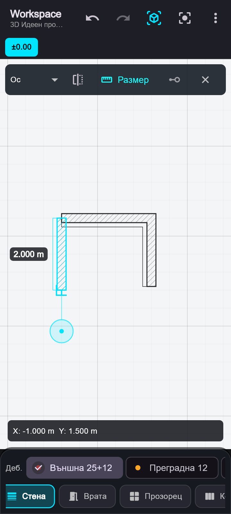
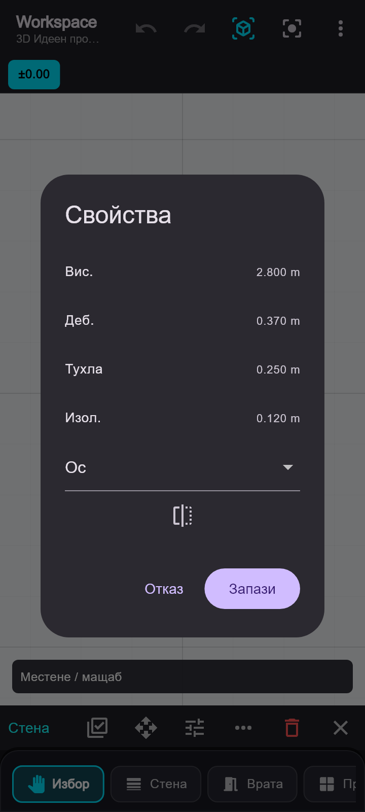

# Стени: свързаност, видимост и точност

## Чертане

1. Изберете „Стена“ и водеща линия: „Ос“, „Вътре“ или „Вън“. При изолирана стена „Ос“ минава през средата на тухлата. „Вътре“ е вътрешното лице, „Вън“ е външното лице на целия състав. Външната страна първоначално е отляво спрямо посоката от началото към края; бутонът за обръщане сменя страната и мести изолацията към нея. Старите записани ляво/дясно запазват физическото си положение.
2. Поставянето използва взаимодействието на гредите в конструктивния BIM: задръжте за 280 ms, за да включите прицелване на 64 екранни пиксела над пръста. Кръгът под пръста, свързващата линия и снап маркерът използват същия `StructuralPointerPainter`. Плъзгайте целта и отпуснете, за да зададете началото. Краткото докосване задава точка на действителното място на докосването; мишката използва курсора.
3. Стената показва динамично тяло, една цел и дължина извън контура. Надписът се отдалечава от всички стени според ъгъла и мащаба. Записаните размерни надписи също се отместват при застъпване със стена. Бързото плъзгане с един пръст мести чертежа; след задържането плъзгането мести само целта. С два пръста можете да местите и мащабирате. Втори пръст отказва текущото прицелване и потиска поставянето до отпускане на всички пръсти. Началото се запазва. Мишката използва среден/десен бутон и колело за навигация, а основния бутон за поставяне и прицелване.
4. Прицелете край по същия начин. При включен „Размер“ отпускането фиксира посоката и отваря панела. При ръчно изключен „Размер“ стената се записва директно. Снапът обхваща край, ръб, пресичане, ос или видима права линия от CAD основата. Пресичането на две оси има приоритет пред проекция към едната ос. Снапът към 0°/90°/180°/270° обхваща до 12° и 28 екранни пиксела (до 0.5 m); останалите посоки са през 15° с по-леко прихващане. Дължините на стените запазват архитектурната точност, без закръгляване на 10 cm като при свободното поставяне на греди.
5. Бутонът с три свързани точки включва „Свързани стени“. След всеки записан сегмент следващият започва точно от предишния край. X завършва веригата. Същият избор остава достъпен в палитрата.
6. „Размер“ е включен по подразбиране и се изключва само ръчно. Записът, „Продължи“, „Край“, отказът и смяната на инструмент запазват избора. Крайната точка фиксира посоката и отваря панела до стената. Докоснете размера за местния цифров блок. Телефонната клавиатура не се отваря. „Край“ записва сегмента и завършва; „Продължи“ записва сегмента и включва свързано чертане. Иконата с компас освобождава посоката; X отказва текущия незаписан сегмент. При ръчно изключен „Размер“ панелът не се отваря.

Панелът запазва мястото си при въвеждане на цифри, следва камерата при навигация и остава в границите на екрана. Празен, нулев размер или размер под 1 mm не може да бъде потвърден. Ръчно въведеният точен размер отменя предишния снап към краен елемент, ако новият край вече не съвпада с него.

## Редакция

Задръжте върху елемент за избор от който и да е неактивно чертаещ инструмент. При избора няма поставяне или запис на геометрия. Бутонът за множествен избор добавя/премахва елементи с докосване или задържане. Бутонът с четири стрелки включва местене на избора: хванете избран елемент и изтеглете. Групата се движи като един комплект; втори пръст отказва прегледа. Вратите и прозорците следват носещата стена или се плъзгат самостоятелно по нея. Осите, зоните, колоните, гредите, плочите, отворите, стълбите, размерите, котите, текстовете и CAD фигурите ползват същия избор и местене.

„Свойства“ показва параметрите на избрания тип. При много елементи показва общите полета, а различните стойности обозначава с „—“. За стените се редактират височина, тухла, изолация, водещо лице и външна страна; общата дебелина се преизчислява. За колоните има и собствена височина, която се използва в 3D. Числата се въвеждат чрез местен цифров блок; имената и текстовете чрез текстово поле. Записът на групови свойства има една Undo стъпка.

Менюто „…“ на стените съдържа редакцията на размер, точка и успоредно местене, както и:

- „Удължи“: изберете стена, после посочете друга стена/ос за общото пресичане или точка за край по същата посока. Може да се скъсява, ако отворите остават в стената.
- „Свържи“: изберете две или повече стени. Краищата се удължават до най-близките общи пресичания; колинеарните пролуки се затварят. Операцията се записва с една Undo стъпка.

- Изборът на стена показва дръжки в двата края. Изтеглянето на дръжка променя края със снап и обновява свързаните стени.
- „Размер“ използва същия цифров блок и запазва началото и посоката.
- „Точка“ позволява посочване по стената и я разделя на два свързани сегмента. Новият възел може след това да се изтегли, за да се получи чупка.
- „Успоредно“ ограничава движението на тялото до нормалата на стената. При изключена опция тялото се мести свободно.
- Свързаните крайни точки следват редакцията. Това включва T връзка по водещата линия или по физическо лице в средата на друга стена.
- Разделянето прехвърля вратите и прозорците към правилния сегмент и преизчислява локалните им позиции. Разделяне през отвор и скъсяване, което оставя отвор извън стената, се отказват с обяснение.
- Всяко записване/редакция има Undo/Redo. Движението остава само визуален преглед до отпускане; втори пръст отказва активната редакция и преминава към навигация.

## Свързване

Телата се изчисляват от водещата линия и дебелината. Общият планов контур е геометрично обединение на телата и връзките между реалните им лица. L ъглите се допълват с митра; много острите ъгли използват ограничено скосяване. T и X пресичанията не оставят вътрешни контурни линии. Диагоналната щриховка се рисува веднъж върху общия тухлен слой и е непрекъсната през връзките.

Същите крайни връзки допълват 3D телата до по-ниската от двете височини. Допълващи тела не се поставят през отвор. Старите записани стени без поле `referenceLine` се четат като централни.

Външната стена е 25 cm тухла + 12 cm изолация. Тухлата има само щриховка и основен контур, без запълване. Изолацията следва зададената външна страна, с тънък контур, без щриховка и без запълване. Слоевете запазват общите възли и връзките независимо от водещата линия. Произволни многослойни композиции и приоритети между материали още не се поддържат.

Надписите в менюто са кратки и използват ARB локализациите (български и английски). Табовете показват само котата; името на етажа е в подсказката. Правилото за кратки мобилни означения без повторения е записано в коренния `AGENTS.md`.

## Проверка

164 преминали теста: архитектурният модул, общите BIM оси, измервателният снап и координатите. Проверките покриват всички комбинации на водещи линии, различни дебелини, L/T/X и остри връзки, CAD основа с изместено начало и милиметрови единици, скрити слоеве, точен размер, продължение, свързана редакция, запазване на отвори и телефонен екран 360×800. Допълнително са проверени ос през тухлата, вътрешно/външно лице и обръщане, приоритет на пресичането на оси, силен прав ъгъл, надписи извън стените при 24 посоки и три мащаба, избор и местене на всички видове, групов преглед/отказ, свойства и запазване на слоевете, удължаване с неподвижни отвори, свързване на три стени и общ Undo. Проверени са постоянният режим за размер, точните дебелини 25+12 cm, свързаността на тухления слой, липсата на запълване, липсата на щриховка в изолацията и по-тънкият ѝ контур. Допълнителните проверки потвърждават задържането за 280 ms, плъзгане на целта при неподвижна камера, директно записване при отпускане, работа с мишка, отказ с втори пръст и отказ на изчакващо задържане при смяна на инструмент.

`flutter analyze` за променените модули и тестове: без забележки.

