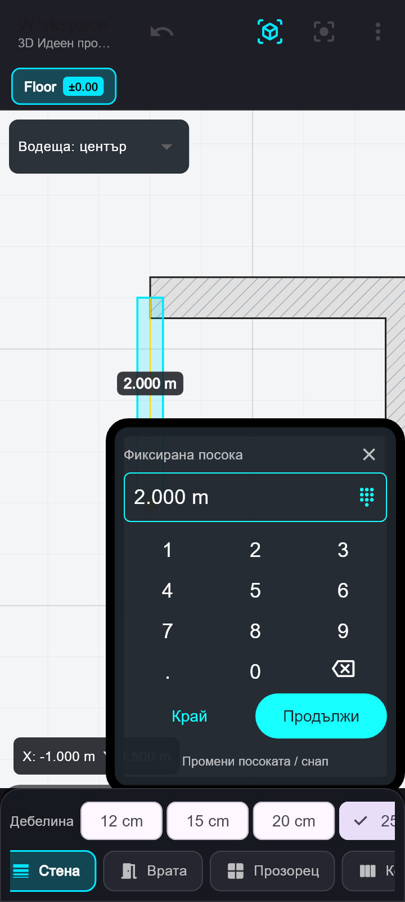

# Стени: свързаност, видимост и точност

## Чертане

1. Изберете „Стена“ и водеща линия: център, ляв край или десен край. Ляво/дясно се определят спрямо посоката от първата към втората точка; така изборът остава еднозначен и при вътрешни стени.
2. Докоснете началната точка. При работа с пръст целта е 64 екранни пиксела над него; при мишка съвпада с курсора.
3. Стената показва динамично тяло, водеща линия, цел и дължина над сегмента. С един пръст можете да местите чертежа; с два — да местите и мащабирате. Мишката използва среден/десен бутон и колело. Навигацията не записва стена и не губи началото.
4. Второто докосване фиксира посоката и крайната точка. Може да използвате снап към край, ръб, пресичане, ос или видима права линия от CAD основата. Снапът към 0°/90°/180°/270° е по-силен; останалите фиксирани посоки са през 15°.
5. До линията се отваря панел. Докоснете размера, за да покажете местния цифров блок. Телефонната клавиатура не се отваря. Размерът се въвежда в единиците на проекта; въвеждането променя дължината, като запазва посоката. Ако е нужен точният край от основата, потвърдете без промяна на размера.
6. „Край“ записва сегмента и завършва. „Продължи“ записва сегмента и използва същия краен възел за начало на следващия. „Промени посоката / снап“ освобождава посоката; X отказва текущия незаписан сегмент.

Панелът запазва мястото си при въвеждане на цифри, следва камерата при навигация и остава в границите на екрана. Празен, нулев размер или размер под 1 mm не може да бъде потвърден. Ръчно въведеният точен размер отменя предишния снап към краен елемент, ако новият край вече не съвпада с него.

## Редакция

- Изборът на стена показва дръжки в двата края. Изтеглянето на дръжка променя края със снап и обновява свързаните стени.
- „Точна дължина“ използва същия цифров блок и запазва началото и посоката.
- „Нова точка“ позволява посочване по стената и я разделя на два свързани сегмента. Новият възел може след това да се изтегли, за да се получи чупка.
- „Успоредно изтегляне“ ограничава движението на тялото до нормалата на стената. При изключена опция тялото се мести свободно.
- Свързаните крайни точки следват редакцията. Това включва T връзка по водещата линия или по физическо лице в средата на друга стена.
- Разделянето прехвърля вратите и прозорците към правилния сегмент и преизчислява локалните им позиции. Разделяне през отвор и скъсяване, което оставя отвор извън стената, се отказват с обяснение.
- Всяко записване/редакция има Undo/Redo. Движението остава само визуален преглед до отпускане; втори пръст отказва активната редакция и преминава към навигация.

## Свързване

Телата се изчисляват от водещата линия и дебелината. Общият планов контур е геометрично обединение на телата и връзките между реалните им лица. L ъглите се допълват с митра; много острите ъгли използват ограничено скосяване. T и X пресичанията не оставят вътрешни контурни линии. Диагоналната щриховка се рисува веднъж върху общото тяло и е непрекъсната през връзките.

Същите крайни връзки допълват 3D телата до по-ниската от двете височини. Допълващи тела не се поставят през отвор. Старите записани стени без поле `referenceLine` се четат като централни.

Това е свързване на целите тела. Отделни зидарски/изолационни слоеве и приоритети между материалите още не се обработват като самостоятелни съединения.

## Проверка

119 преминали теста: архитектурният модул, общите BIM оси, измервателният снап и координатите. Новите проверки покриват девет комбинации на водещи линии, различни дебелини, L/T/X и остри връзки, CAD основа с изместено начало и милиметрови единици, скрити слоеве, точен размер, продължение, свързана редакция, запазване на отвори и телефонен екран 360×800.

`flutter analyze` за променените модули и тестове: без забележки.

