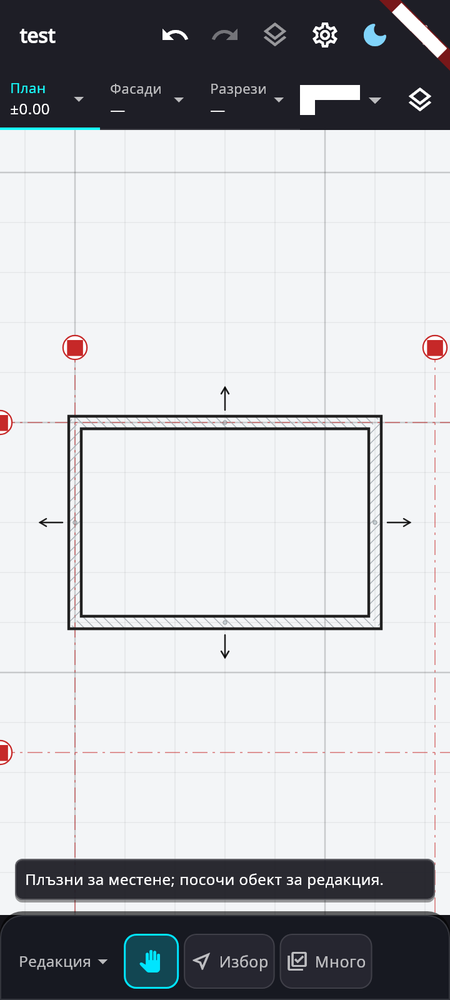
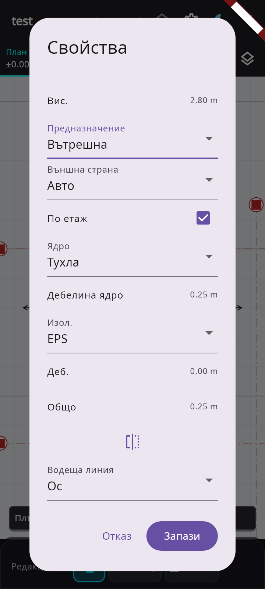

# Външни стени: предназначение и посока

Стените започват с автоматично предназначение и автоматична външна страна.
Избраният тип дава предварителна стойност. След записана редакция се анализира
цялата мрежа от стени на етажа; не е нужно предварително да има означени помещения.

Затворените пространства се приемат за вътрешни. Ограждащите стени се насочват
навън, а стените между вътрешни пространства стават вътрешни. Разпознаването
поддържа начупени контури, Т-връзки, дъги и отделни сгради. Отворите не прекъсват
контура, а декоративните профили и опашките на дървените стени не го определят.
При незатворена или двусмислена мрежа се запазват предварителните стойности.

При чертане и избор стрелка показва външната страна. Прекъснатата стрелка е
предварителна; плътната е определена автоматично или зададена ръчно. След
автоматична промяна стрелките остават за оглед до следващо чертане или избор.
Те са помощни обозначения и не участват в печат или експорт.

В „Свойства“ предназначението предлага „Авто“, „Външна“ и „Вътрешна“.
Страната има отделен автоматичен/ръчен режим. „Обърни“ задава ръчна страна;
връщането към „Авто“ разрешава повторното ѝ определяне. Двете настройки са
независими и се запазват при запис, разделяне, копиране и огледално преобразуване.
Вътрешните дворове се уточняват ръчно по ограждащите стени.

Разпознаването влиза в същата Undo стъпка като редакцията. То запазва
физическите ядра, материалите и отворите. Водещата линия може да се премести
при обръщане; разпознатите физически ъгли остават свързани.

Характеристиката „Носеща“ е премахната от моделите, записваните данни,
каталожните филтри и редакторите. Стоманобетонната стена 25 cm остава с явен
материал бетон. Добавени са вътрешна тухлена стена 25 cm и вътрешен газобетон
10 cm. Имената, подсказките и съобщенията използват ARB на български и английски.

Проверките включват геометрия, независими ръчни корекции, Undo/Redo,
запис/отваряне, преобразувания, телефон 360×800 и изключване на стрелките от
моделния слой. Промененият модул и тестовете му преминават статичната проверка.
В разширените регресионни проверки са установени и 13 предварително
съществуващи провала, възпроизведени върху непроменения HEAD.
