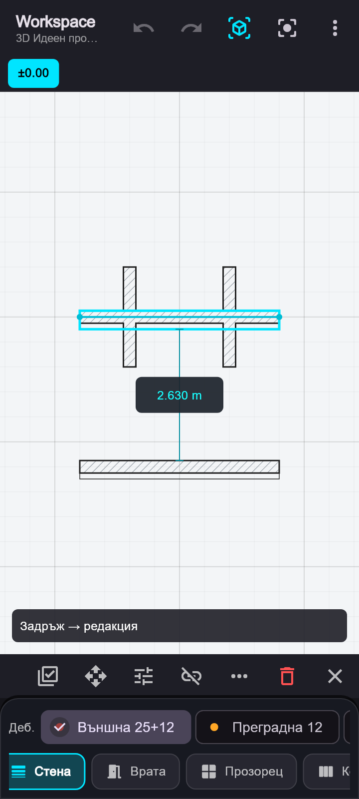
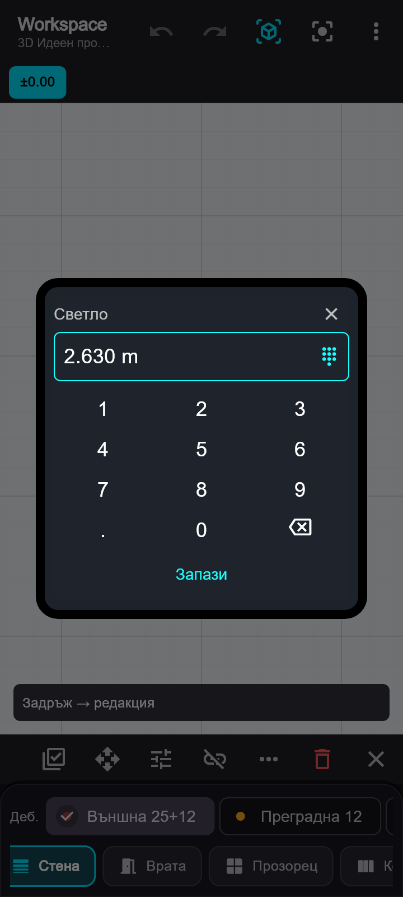
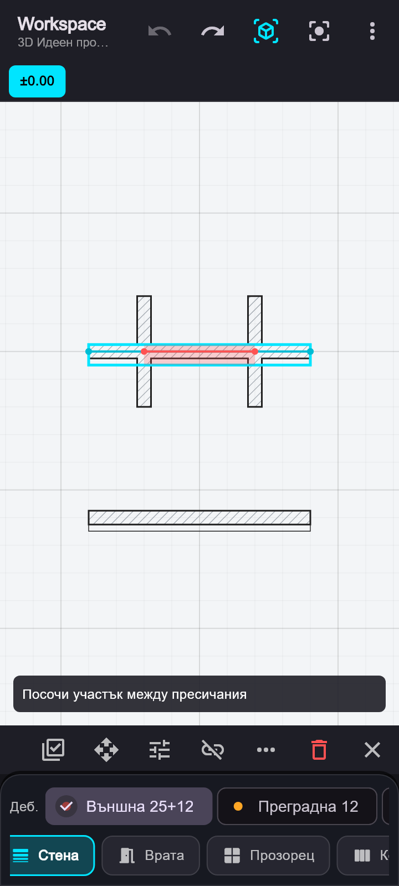

# Стени: автоматична водеща линия, срязване и светъл размер

## Водеща линия

Началният снап към съществуваща стена определя водещата линия на новата: вътрешно лице → „Вътре“, ос на ядрото → „Ос“, външно лице → „Вън“. Използват се реалните лица и ос на тухлата/бетона, независимо от записаната водеща линия на съществуващата стена. Изборът се вижда в горната лента още при прицелване.

При задаване на посоката външната страна се ориентира спрямо съществуващата стена. В перпендикулярен краен ъгъл ядрото се насочва към съществуващото тяло. Ръчната промяна на водещата линия или страната отменя автоматичната ориентация за текущия сегмент. При „Продължи“ следващият сегмент използва предишната стена за начална връзка.

Съединяването разпознава и допир на край към физическо лице, когато водещите линии не се пресичат в границите на сегментите. Ядрото се допълва до физическия край, така че слоевете да се съединят и при различни водещи линии.

## Избор и местене

Избирайте елементи със съответния инструмент (стени със „Стена“, колони с „Колона“ и т.н.). Инструментът остава активен след избор; навигацията не избира елементи. В режим редакция задръжте пръста 280 ms преди местене. Бързо докосване не селектира и не мести елемент; бързото плъзгане навигира. След задържането са необходими повече от 6 екранни пиксела движение, за да започне местене. Трепване на пръста не създава редакция или Undo стъпка. Това важи и за краищата на стените и за групово местене.

Множественият избор запазва бързото добавяне/премахване с докосване, когато местенето е изключено. При включено местене на групата отново е нужно задържане. Мишката запазва директното взаимодействие. Втори пръст отказва редакцията и преминава към навигация.

## Срязване

„Срежи“ в менюто „…“ използва едно посочване на стената. Участъкът между най-близките пресичания и/или краища се подсветва червено при натискане; отпускането го премахва. Точките на пресичане са обозначени. Без пресичания посоченият участък е цялата стена. Ctrl + клик с мишката изпълнява същата операция директно.

Останалите части запазват дебелина, слоеве, страна, височина и отворите с правилни носещи стени и локални позиции. Отвор изцяло в премахнатия участък се премахва с него. Ако границата на среза минава през отвор, операцията се отказва. Съседните стени остават неподвижни. Една Undo стъпка възстановява целия срез.

„Раздели“ запазва предишния срез с линия от две точки през избраните стени. Той създава отделни сегменти, без да премахва участък. X на лентата за избор отказва активния инструмент.

## Светъл размер

При избор на една стена се показва светлият размер до най-близката успоредна стена от всяка страна. Използват се крайните лица на целия състав, включително изолацията. Стени без обща проекция по дължината не участват. Посоката на чертане и водещите линии не променят измерването. Надписът се разполага извън стените и следва камерата.

Докосването на размера отваря панел „Светло“ с местен цифров блок и „Запази“. Не се отваря телефонната клавиатура. Новата стойност премества избраната стена успоредно, като запазва съседната успоредна стена на място. Свързаните краища се плъзгат по основите; ако излизат извън стария им край, числовата редакция удължава необходимите опори. Другите краища на опорите и физическите места на техните отвори се запазват. Невалидна геометрия се отказва. Операцията има една Undo стъпка.

## Телефон 360×800

223 теста минават за архитектурния модул, общите BIM оси, измервателния снап и координатите. 15 нови теста проверяват автоматичните водещи линии, свързаността на тялото и ядрото за различните комбинации, реалните светли размери, завъртени стени, запазване на неподвижната основа и отворите, атомарно срязване и Undo, задържане и трепване на пръста, Ctrl + клик и действителните операции на телефон 360×800. `flutter analyze` за архитектурния модул и тестовете е без забележки.

