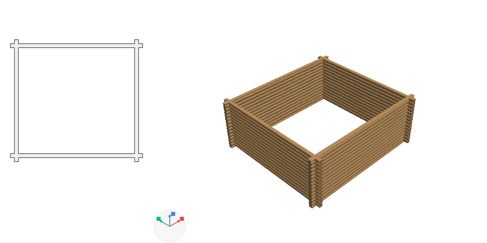
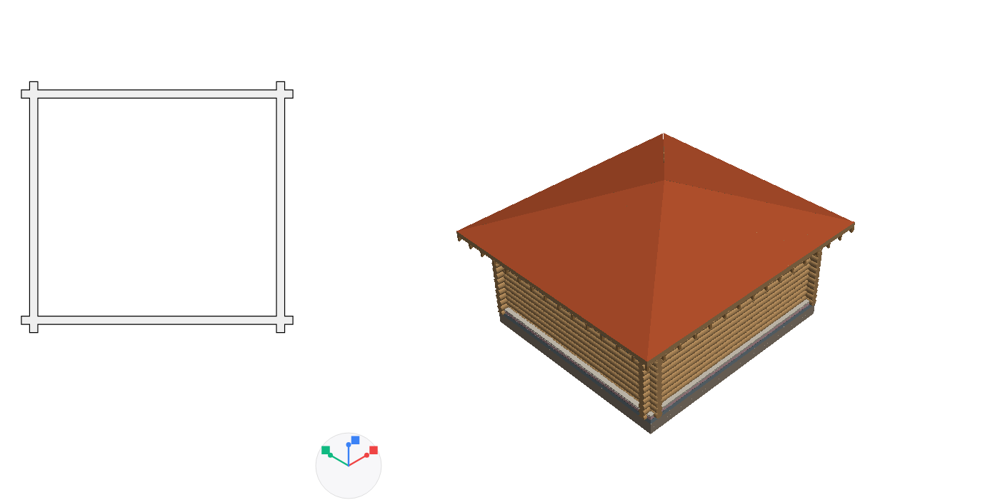
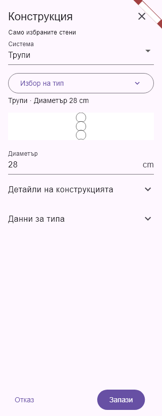
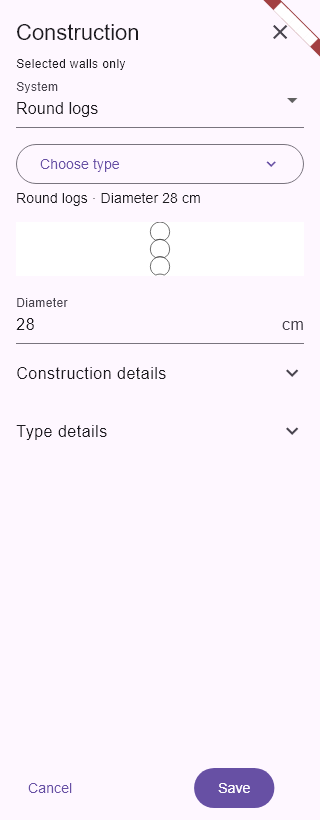

# Единна система за избор и редактиране на стени

## Последователност

1. **Система**: слоеста стена, трупи, лека преграда или термопанели.
2. **Избор на тип**: само готовите типове от активната система. Показват се и началните шаблони, включително в съществуващи проекти.
3. **Размери**: текущата конструкция се описва от действително въведените размери. Името на изходната стена не определя конструкцията.
4. **Детайли на конструкцията**: разгъваеми настройки, специфични за съответната система.
5. **Данни за типа**: собствено име, външна/вътрешна стена, носеща функция и запазване в каталога.

При пробване на друга система редакторът пази въведените размери за всяка система до затварянето на прозореца. Връщането към предишната система възстановява нейните полета. Отказът не променя модела.

## Как се чете всяка конструкция

| Система | Основни размери | Допълнителни настройки |
| --- | --- | --- |
| Слоеста | Материали, роли и дебелини на слоевете; обща дебелина | Покрития, цокъл, класификация |
| Трупи | Един диаметър; няма редактиране на материал или списък с произволни слоеве | Процент застъпване, дължина на краищата, каси и луфт за слягане |
| Лека преграда | Обшивки и дълбочина на конструктивната кухина | Стъпка и ширина на профилите, дебелина на метала, вата |
| Термопанели | Слоеве на панела и отделна дълбочина на подконструкцията | Модул, ориентация, профили и монтаж спрямо колоните |

Пример: избрана стена **25+12 → Система: Трупи → Диаметър: 24 cm**. Старото име не остава в бутона за избор. Активното описание показва трупи и текущия диаметър. Промяната се прилага върху избраните стени; редактирането на споделен каталожен тип продължава да показва броя засегнати стени.

При смяна на системата се изчистват неподходящите монтажни връзки от предишната система. При редактиране в рамките на същата система връзките се запазват.

## Поправка на стените от приложения проект

Изходният файл съдържа четири стени с действителен диаметър **0.24 m**. Разликите в плана идваха от хоризонталното срязване през различни хорди на разминатите кръгли трупи. Допълнително, нестабилното свързване на близки върхове можеше да прекъсне контура и да скрие част от стената.

- **План**: номинална ширина, равна на диаметъра, със запазени отвори и издадени краища. Ъглите имат общ чист контур и само един собственик на щриховката.
- **Разрез и 3D**: действителна кръгла геометрия, процентно застъпване, половин стъпка между перпендикулярните стени и реални сглобки.
- **Точност**: локални координати при повторното триангулиране на фасети, изчисляване на запълването с двойна точност и постоянна идентичност на вече свързаните върхове в срезовете.
- **Съседни елементи**: номиналният план пази изрязванията за колони, плочи, отвори в плочите и покриви. Не се добавят застъпващи се материални щриховки.
- **Работа в план**: за стени само от трупи контурът се получава директно, без да се построява цялата 3D сглобка.

Автоматичното подравняване/изрязване продължава да използва съществуващата политика за защитените краища на трупите. Монтажните възли не се местят при смяна на визуалното представяне на плана.

## Контролни изображения

## Проверки

Регресионният пример `test/fixtures/architect/log_house_24.json` запазва геометрията на подадения BIM пакет. Новите проверки обхващат пет височини на плана, ширината по дължината на всяка стена, издадените краища, материалните контури, напречните разрези, видимите кръгли повърхности от двете страни, отворите и контактите с колони/плочи. Мобилните проверки обхващат смяната 25+12 → трупи, възстановяването на размерите и избора между четирите системи на български и английски.

- Осемте нови проверки преминават; контролните изображения са прегледани.
- Разширената регресия: **263 успешни теста**, включително специалните стени, покривите, фасадите, разрезите, каталога и защитата на издадените краища. Пет стари теста не преминават: четири за контекстните команди за изрязване и един за изписването `3.00 m` спрямо `3 m`.
- В отделна проверка на редактора има още един стар неуспешен тест за отваряне на контекстното меню.
- Същите шест неуспешни теста са възпроизведени в изолирано копие на **8f89c05**, без настоящите промени: 19 успешни и 6 неуспешни. Те не са поправяни в тази задача.
- Статичният анализ на архитектурния модул и променените тестове е чист. `git diff --check` е чист.

Оригиналният ZIP пакет не е променян. Не е създаван нов инсталационен пакет на приложението.
